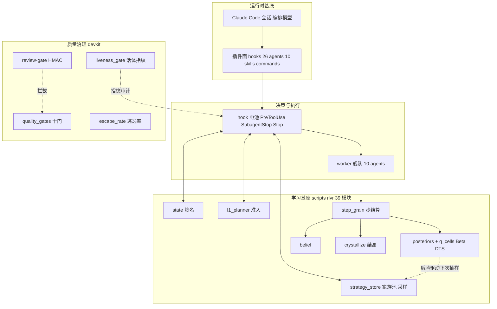
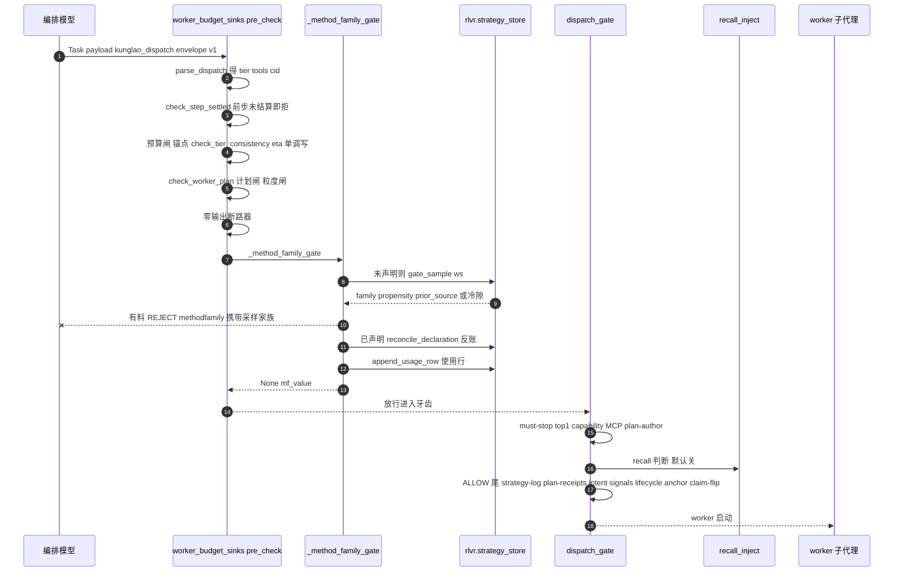
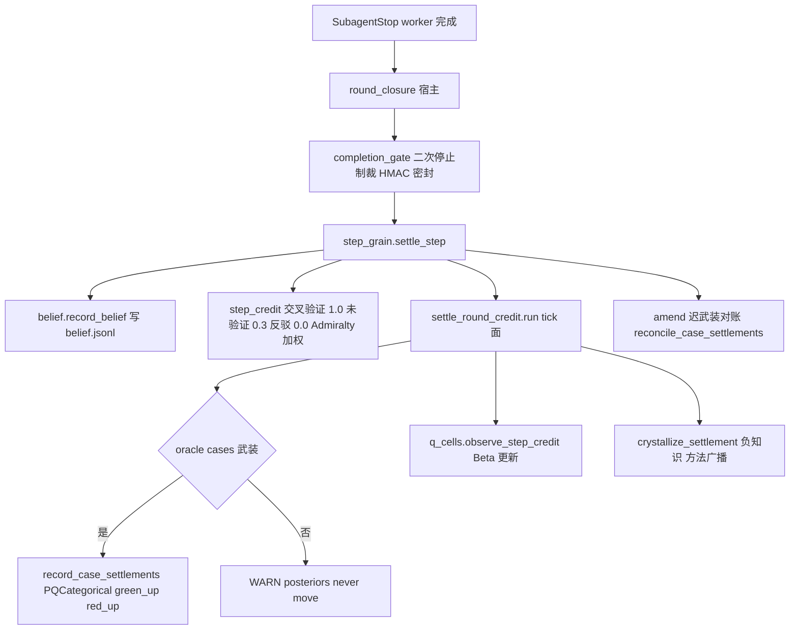
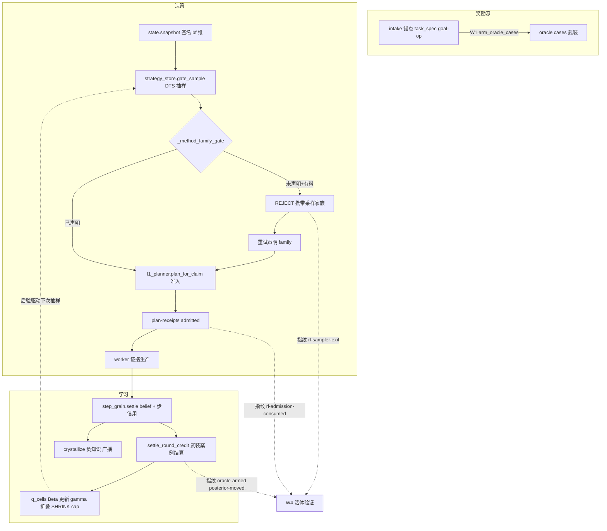
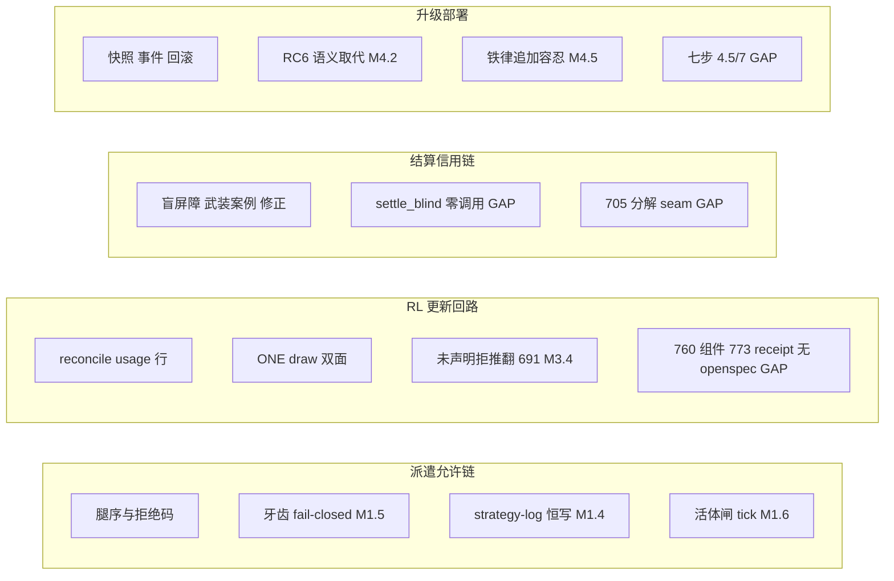
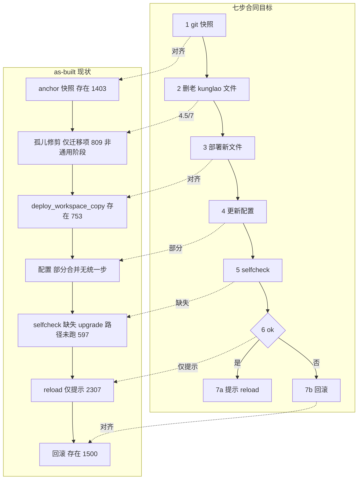

# kunglao-agent 项目技术文档（as-built 全量单册）

- 基准：dev `518e2d10`（#776 合并后）；工作树 `.worktrees/feat-773-executor`
- 证据立场：§4 设计面 = spec 层清查（86 能力/17 法则/7 矛盾，逐字出处，全文见 §12）；§5 实现面 = 代码清查（359 模块，全文见 §13）；§8 = 五链逐 face 对账（28 MATCH/6 MISMATCH/10 GAP，全 file:line，全文见 §14）。
- 图：§3.2 派遣时序、§3.3 结算链、§6 RL 全景、§8.4 对账图、§11.4 升级事务全部 Mermaid（GitHub/VS Code 直渲）；分层与模块导入图的 drawio 可编辑源在 `diagrams/`。

---

## 1. 系统概览

kunglao-agent 是跑在 Claude Code 会话里的自主逆向工程编排系统：编排模型按 claim 分派专家 worker 子代理，每个结论必须通过独立机械验证（oracle/red-team）才得 PROVEN；全过程写入 `runs/` 账本（append-only + 折叠读），并以 RLVR 把每次结算反馈进 Beta 后验，使下一轮策略（方法家族选择/claim 排序/动作准入）由数据驱动。

| 层    | 组成                                                            | 职责                                           |
| ---- | ------------------------------------------------------------- | -------------------------------------------- |
| 运行时  | Claude Code 会话 + 插件（26 hooks / 10 agents / skills / commands） | 承载编排模型与 worker 子代理                           |
| 决策执行 | hook 电池 → worker 舰队 → 结算链                                     | 派遣执法、证据生产、结算入账                               |
| 学习基座 | `scripts/rlvr/` 39 模块                                         | 状态签名/Beta 后验/Thompson 采样/L1 规划/belief/步结算/结晶 |
| 质量治理 | `devkit/` 14 文件 + review-gate                                 | 十门/活体指纹/逃逸率/验证与延期门                           |

规模：scripts/ 280 py + hooks/ 26 + rlvr/ 39 + devkit/ 14 + agents/ 10 = **359 Python 模块 + 10 agent 定义**；测试 5,930+；账本路径 69。

## 2. 架构设计

### 2.1 四条骨架事实

- 编排模型不直接做事：一切产出由 claim 派遣的 worker 生产；编排器只读账本、做决策、写 envelope。
- hook 电池是唯一执法面：派遣必经 `worker_budget.pre_check` + `dispatch_gate` 牙齿；完成必经 `completion_gate`/`round_closure`。
- 账本是真相：`runs/` 69 个路径字面量，append-only + 折叠读。
- RL 基座无特权：策略只"调度实验/检索/验证，永不书写假设内容"；唯一强制面 = #773 W2"未声明即拒（携带采样家族）"。

### 2.2 十七条跨面法则（架构宪法，逐字出处见 §12 表）

单写者墙｜注册表单源｜一个实现双面共享｜单一时间轴｜append-only+折叠读｜写入门/读屏障｜读 fail-open 写 fail-closed｜受控词表｜目标函数不可运行时自调｜maker≠checker｜决策权宪法｜特征键控｜蒸馏克制｜无中央注册表｜devkit/产品隔离｜诚实空值｜无证据即均匀先验。

## 3. 调用关系（逐函数级）

### 3.1 hook 注册链（26 行，单源 `scripts/wire_up_settings.py::WIRE_UP_HOOK_WIRING`）

| 事件           | matcher | 执行序                                                                                                           |
| ------------ | ------- | ------------------------------------------------------------------------------------------------------------- |
| PreToolUse   | Agent   | `env_check_gate` → `worker_budget` → `dispatch_gate` → `recall_inject`                                        |
| PreToolUse   | Bash    | `heartbeat_touch` → `orchestrator_tool_guard`（+MCP 面）                                                         |
| PostToolUse  | Agent   | `worker_budget` → `worker_pulse` → `state_anchor`                                                             |
| PostToolUse  | Bash    | `violation_capture` → `bash_fact_guard`                                                                       |
| SubagentStop | —       | `round_closure`                                                                                               |
| Stop         | —       | `completion_gate` → `workguard_gate`                                                                          |
| 双 matcher    | —       | `write_guard` / `rt_read_barrier` / `evidence_pin_guard`                                                      |
| 其他           | —       | `cost_input_capture` / `step_record_capture` / `session_start` / `compact_continuity` / `user_signal_capture` |

激活语义：注册≠激活。`hook_activation.py --wire-up` 只写注册；Phase 0 `--tier/--set-active` 激活 + `HOOK_TTL_MINUTES=30` TTL 由 `--renew` 续期；无 `.hook_state.json` = 全体休眠。

### 3.2 派遣允许链（worker_budget_sinks.pre_check，逐腿）

**逐腿细节与拒绝码**（`_reject(name,...)` 单点 → `runs/gate-telemetry.jsonl`）：

| 腿              | 函数                          | 拒绝码            | 条件                                    |
| -------------- | --------------------------- | -------------- | ------------------------------------- |
| 步结算屏障          | `check_step_settled`        | —              | 前步未结算（超 TTL pending 放行+WARN 一次）       |
| facts-snapshot | —                           | `snapshot`     | prompt 缺 `facts-snapshot:`            |
| 优先级审计          | `check_priority`            | `devreason`    | 偏离 #1 无 `agent-reasoning:`            |
| 方法家族           | `_method_family_gate`       | `methodfamily` | 未声明（有料→拒并携带采样家族 W2）/未注册               |
| 采样出口遥测         | `_gate_sample`              | —（事件）          | 异常 → `gate_sample_failed` 事件 + stderr |
| tier 一致性       | `check_tier_consistency`    | `tiercons`     | envelope tier ≠ action_tier           |
| 计划闸            | `check_worker_plan`         | `plan`         | 再派发无 worker 亲写计划                      |
| 粒度闸            | `check_claim_granularity`   | `granularity`  | ≥8 步或 ≥2 族各 ≥2 步                      |
| 零输出断路器         | `check_zero_output_circuit` | `zerooutput`   | (tool,claim) 指纹重复零产出                  |
| STALLED 补救     | `check_convergence_health`  | —（放行）          | rc=1 + `remedy: decompose`            |
| verifier 通行    | lib_kunglao 单谓词             | —（放行）          | PROVEN claim 的 verifier 派发            |

envelope v1：`{"kunglao_dispatch":{"version":1,"claim":"C-NN","tier":N,"tools":[...],"agent":"..."}}`；`method_family` 双面声明解析（`_mf432.declared_value`）；**咽喉点纪律（#432）**：该字面量只允许在 worker_budget_sinks（freeze-test 钉死，dispatch_gate 出现即红）。

### 3.3 结算与信用链（逐函数）

盲结算屏障：`settlement_scorer` 只认 blind builder 输入（读前拒绝）；`runs/experience.jsonl`/method-family-log/q-cell-log 对 settler/RT 读屏障；`step_ledger` hash-only 行（原文永不落盘），未认证证据 escrow 只能过期。

### 3.4 派遣 REJECT 三重回滚（dispatch_gate.py:1821-1849）

REJECT 时：`undo_dispatch_anchor`（#623 撤锚行）→ `reopen_claim_no_worker`（#624 复原 OPEN→IN_PROGRESS 翻转）→ `cancel_step_open`（#690 撤销开启的步）——三连无 spec 记载（GAP，见 §14）。

## 4. 模块设计（核心八模块深潜）

### 4.1 `rlvr/strategy_store.py`（家族池 + 采样出口）

- 落盘：`store_root()` = `KUNGLAO_POSTERIOR_STORE` env 覆盖，否则 `scripts/rlvr/patterns/`；`PosteriorStrategyStore(ws)` 走 ws 级 `runs/posterior-store.jsonl`（`posteriors.STORE_REL`）+ 锁 `runs/.posterior-store.lock`。
- `append_store_row(...)` → posterior-store/1 行：workspace_id / arm_key=method_family / feature_key=feature_key_of(ws) / fingerprint / status / credit 0..1 截断 / #705 agent_type+claim+credit_kind / #689 outcome_class（infra 行不进 warm pools）。
- `method_sample(fp)` receipt 真实形状：  
  `{"schema":"q-cell-sample/1","signature_hash":"aea12f53…","family":"static-decompile","gamma":0.9,"candidates":{"static-decompile":{"p_llm":1.0,"alpha":1.67,"beta":1.33,"theta":0.857,"weight":0.857}},"prior_source":"history"}`  
  三源先验链：`proposal_prior_labeled()`（measured history → intake llm-prior → cross-task store；label ∈ history/llm_prior/none）→ `_store_prior` 兜底；None = 诚实冷隙，永不造家族。
- `gate_sample(ws)`（#773 W2 决策封装）/ `reconcile_declaration(ws, declared)`（#691 反账遥测）/ `method_lead`（advisory）——三面一个 `method_sample`（法则 3）。
- 姿态演进：偏离=记录（sample_deviation）不变；**未声明+有料=拒一次携带采样家族**（owner 2026-10-18，推翻 2026-10-14 "never rejects" 对未声明例外的适用——spec 增补待办 M3.4）。

### 4.2 `rlvr/l1_planner.py`（准入策略）

- `ACTION_KINDS = ("dispatch","park","split","verify","reuse","distill")`；`DISTILL_COST=1.5`（词表成员非触发规则）。
- `plan_for_claim(ws, claim, *, dispatch_cost, store=None, rng=None, knowledge=None, state_signature=None, gamma=None, fold_view=None)`：候选 ratio=value/cost 降序；`_admit` 贪心预算准入 1..k（park cost-0 地板；NaN/±inf/负/bool 边界拒）。
- receipt：`{admitted:["dispatch/C-001",…], chosen:{key,…}}` → W3 的 plan-receipts.jsonl 数据源。
- `advisory_factors(ws, actions, rng)`：knowledge-solved claim 的 dispatch share 乘法降权——priority_ratio 排序面唯一生产调用点。

### 4.3 `rlvr/posteriors.py` + `q_cells.py`（DTS 内核）

- `PosteriorView.sample(rng) = [rng.betavariate(alpha,beta) …]`（每格一抽，宽度即探索）；`fold(ws, schedule)` γ 折叠读（原始行不改写）；`THETA_FLOOR=0.1` 败臂地板（可复活不删除）。
- `q_cells.arm_key`：4 段 + #705 可选 agent_type 第 5 段（falsy → 字节回退 4 段确定性墙）；`SHRINK_CAP` 知识转移收缩上限（法则 12）。

### 4.4 `rlvr/belief.py`

- `belief/1` 行（真实实例）：`{"schema":"belief/1","ts":"…Z","claim":"C-009","step_ref":"8e2e8cbe…","open_status":"PROVEN","declared_unknown":[]}`；`declared_unknown` 非空 → state 签名 `bf=u` 维。

### 4.5 `rlvr/crystallize.py`

- 失败步 → 类级负样本 `(signature_class, agent_type, method_family)`；认证成功步 → 方法广播（"never the answer"）；`revoke_claim` 派生存储原子重写；结算笼 fail-open。

### 4.6 `hooks/worker_budget_sinks.py`

- `pre_check` 腿序（§3.2）；`_method_family_gate`（#432 咽喉 + #773 W2）；`_gate_sample`/`_sample_reconciliation`/`_emit_sample_deviation`；ALLOW 尾 `_dispatch_lifecycle(method_family=mf_value)`。
- `_reject` 单点 → `gate-telemetry.jsonl`（fail-open，ledger 不可写不改判）。

### 4.7 `hooks/dispatch_gate.py`

- 牙齿：`_must_stop_dispatch` → `_top1_enforcement`（rank≥2 无 `agent-reasoning:` REJECT）→ `_capability_guard` → MCP 前缀门 → plan-author。
- ALLOW 尾：`_log_strategy_dispatch`（#496 行）→ `_write_plan_receipt`（W3）→ `_record_dispatch_intent` → signals → anchor → flip。
- REJECT 三重回滚：`undo_dispatch_anchor`（#623）→ `reopen_claim_no_worker`（#624）→ `cancel_step_open`（#690）。

### 4.8 `devkit/`

GATES 1-10 + `liveness_gate`（`--ledger`/`--smoke`）+ `escape_rate` + `verification_gate` + `deferral_guard` + `invariants/registry.json` + `spec_coverage`。提交链 review-gate（HMAC mint，stale 即拦）。

## 5. 账本面 schema（字段级 + 实例行）

| 账本                                | schema            | 字段（实例值合成）                                                                                                                                                        |
| --------------------------------- | ----------------- | ---------------------------------------------------------------------------------------------------------------------------------------------------------------- |
| `runs/belief.jsonl`               | belief/1          | `{schema, ts, claim:"C-009", step_ref:"8e2e…", seen:[{id,status}], declared_unknown:[], open_status:"PROVEN"}`                                                   |
| `runs/plan-receipts.jsonl`        | plan-receipt/1    | `{schema, ts, claim:"C-001", admitted:["dispatch/C-001"], chosen:"dispatch/C-001"}`                                                                              |
| `runs/strategy-log.jsonl`         | —                 | `{ts, event:"dispatch", strategy, declared, claim, attempts_at_snapshot [, sampled_family, propensity, source:"gate"]}`                                          |
| `runs/posterior-store.jsonl`      | posterior-store/1 | `{schema, ts, workspace_id, arm_key, method_family, feature_key, fingerprint, status, credit 0..1, censoring, outcome_class [, agent_type, claim, credit_kind]}` |
| `runs/method-family-log.jsonl`    | usage 行           | `{cid, method_family, row_agent, tier, tools, propensity, sampled_family, prior_source}`                                                                         |
| `runs/kunglao-*.jsonl`            | kunglao-event/1   | `{ts, action∈EMIT_ACTIONS ~150 词, actor, arm, channel, claim, detail, exit, tick, epoch, trace_id}`                                                              |
| `runs/gate-telemetry.jsonl`       | —                 | 每 worker_budget REJECT 一行                                                                                                                                        |
| `runs/upgrade-snapshot.<ts>.json` | —                 | `_framework_snapshot`（CLAUDE.md/settings/hook_state 的 sha）                                                                                                       |

## 6. RL 学习回路（全景 + 数学）

数学：后验 `Beta(alpha,beta)`，γ 折叠读（原始行不改写）；DTS 抽样 `rng.betavariate(alpha,beta)` 每格一抽（宽度即探索）；臂权重 `weight = prior · max(theta, THETA_FLOOR=0.1)`；propensity = 抽中家族 weight / Σweights；步信用 ∈ {1.0 交叉验证, 0.3 provisional, 0.0 反驳}（Admiralty 字母加权）。修复史三断点：奖励源死→W1；采样器无出口→W2；准入无调用方→W3；W4 = 五指纹翻绿（预算门）。

## 7. 质量与开发机制

devkit GATES 1-10（需求/回归/工程/测试有效性 mutation 基线 #663/子代理审查 #462/agents 契约 #492/doc-sync #446/治理绑定 #867/发现面 #866/活体 #772）+ 反馈边 `liveness_gate`（`--ledger <ws>` 免费随 PR；`--smoke` 发布档真跑+取指纹）/ `escape_rate.py`（v0.1.6-rc2 首行 100% 逃逸，>10% 规则触发）/ `verification_gate`（行为 PR 必带 Verification 块）/ `deferral_guard`（延期必有阻塞 issue）/ `spec_coverage`（29 开变更 58 违规待迁移）。提交链 review-gate：HMAC mint + stale 即拦；pre-commit quiet 集 = 注册表减 Gate 2（lockstep 测试钉死）。

## 8. 设计偏离分析（五链对账）

### 8.1 对账主表（28 MATCH / 6 MISMATCH / 10 GAP；逐条 file:line 见 §14）

| 流程 | MATCH | MISMATCH | GAP | 判定 |
|---|---|---|---|---|
| 1 派遣允许链 | 5 | 3 | 2 | 部分偏离 |
| 2 结算/信用链 | 9 | 0 | 2 | **对齐** |
| 3 RL 更新回路 | 5 | 1 | 3 | 部分偏离 |
| 4 升级/部署事务 | 5 | 2 | 1 | 部分偏离 |
| 5 init 流 | 4 | 0 | 2 | **对齐** |

### 8.2 六处 MISMATCH——同一类：代码因 owner 裁决正当演进，spec 文本冻结未跟

| # | 代码事实 | 冻结的 spec | 动作 |
|---|---|---|---|
| M1.4 | `_log_strategy_dispatch` 每放行写 default 行（owner review 2026-10-10） | issue-496 ③"无标记=行为不变" | spec 补记 |
| M1.5 | 牙齿 fail-closed（owner 2026-09-28） | issue-496 ①"FAIL_OPEN" | spec 补记 |
| M1.6 | 活体闸读 tick-continuity（#754 取代） | loop-engineering F1"读 activity_ts" | design doc 标注取代 |
| M3.4 | 未声明+有料=拒携采样家族（owner 2026-10-18） | issue-691 "never rejects" | **issue-691 增补 W2 修正案** |
| M4.2 | 窗口内新建日志文件被误判（同根） | 同上 | 同上 |
| M4.5 | 铁律追加容忍（#764） | 753 "逐字节" | spec 增补 |

### 8.3 十处 GAP 重项

`settle_blind`（#687）零生产调用=盲结算从未接线；#774 七步在码 ~4.5/7（selfcheck 不在 upgrade、reload 仅提示、无统一 configure/prune）；#705③ solve/verification 分解 seam-only；#773 W1-W3 与 #760 组件无 openspec 目录；dispatch REJECT 三重回滚无 spec 记载；`log_setup.py` 零导入契约面。

### 8.4 对账图（⚠=偏离/缺口）

## 9. 设计面全景（86 项能力 × 8 域）

| 域 | 行数 | 代表能力 |
|---|---|---|
| A 派发与闸门 | 16 | 心跳存活闸 A1 / plan-first A2 / 粒度 A3 / STALLED 补救 A4 / tier 一致性 A5 / 步结算屏障 A6 / 零输出断路 A7 / must-stop+MCP A8 / verifier 通行 A9 / 能力卡 dormant A10 / 闸门遥测 A11 / 注册表单源 A12 / 七元组 envelope v2 A13 / 唤醒决策 A14 / L1 planner A15 / 策划层 A16 |
| B 结算与奖励 | 15 | 盲结算 B1 / 盲墙延伸 B2 / 事实认证 B3 / verifier 凭据 B4 / 结算公平 B5 / PQ 后验 B6 / 复现 oracle B7 / 步级信用 B8 / 信用修正 B9 / 案例后验修正+迟武装 B10 / 奖励源 B11 / 步经验账本 B12 / 进度时间线 B13 / 完成判定 B14 / 约束见证 B15 |
| C RL 循环 | 15 | agent 条件化 Q C1 / 知识转移 C2 / 假设桥 C3 / 障碍阶梯 C4 / 归因+选项死亡 C5 / 特征挖掘 C6 / TS 轮种 C7 / 熵算子 C8 / RL 输出对账 C9 / recipe 臂 C10 / 源可靠性 C11 / 合并账本 C12 / 结晶 C13 / 静默台账 C14 / 治理清扫 C15 |
| D 调度存活观测 | 13 | 机制调度器 D1 / trace 身份 D2 / emit 双向门 D3 / 工具价值 D4 / 回溯环 D5 / statusline 健康 D6 / 治理绑定 D7 / 事件 schema D8 / 定时任务 D9 / YAML 防线 D10 / 进度耦合 D11 / 派发遥测 D12 / 存活三件套 D13 |
| E 升级部署 init | 6 | 依赖面闸 E1 / intake 电池 E2 / 模板卫生 E3 / 事实落地 E4 / 路径旗标 E5 / verifier 派发 E6 |
| F 知识注入 | 8 | 在线蒸馏 F1 / 脚本收割 F2 / 蒸馏脊柱 F3 / 查询表述 F4 / distill 动作 F5 / 跨区记忆 F6 / jsVMP F7 / 专家 v2 F8 |
| G 评估实验 | 6 | 五/七臂矩阵 G1 / K-vs-CC 协议 G2 / 三臂消融 G3 / ε-greedy 对照 G4 / 重放标尺 G5 / 内核判定 G6 |
| H devkit | 7 | 四门框架 H1 / Gate5 审查 H2 / 活体指纹 H3 / 单测规范 H4 / 逃逸 KPI H5 / 毕业闸 H6 / 参数治理 H7 |

（每行能力的 spec 路径 + operative 引文 + 声明接线 + 状态，全文见 §14 附表。）

## 10. 实现面全景（附录 B 摘要）

- 359 模块：scripts 280 / hooks 26 / rlvr 39 / devkit 14 / agents 10
- 零调用者：`scripts/log_setup.py`（CONTRACT_MODULES 契约面）
- 同 stem 孪生 ⚠：completion_gate、heartbeat_touch（hooks vs scripts）、posteriors（scripts vs rlvr）
- hook 链 26 行单源 §3.1；账本 69 路径 writer 映射见 §14

## 11. 升级事务：七步合同 vs as-built（Mermaid 对账）

## 12. spec 层设计面全景（86 项能力逐字出处表）

> 完整逐字引文表（86 行 × spec 路径 × operative 引文 × 声明接线 × 状态，加 17 法则全文与 7 矛盾原文对照）见本目录 `appendix-spec-inventory.md`——该文件即设计面清查全文，随本册一并交付。

## 13. 实现面全景（359 模块逐文件表）

生成方法：AST 解析 docstring/公开函数 + 全仓 grep import 边（scripts/hooks/devkit/kunglao_agent_cli/tools/conftest.py = product；tests/ = tests）。工作树只读，未改动任何文件。

引用计数列：product=N / tests=N（导入该模块的非测试文件数 / 测试文件数）。

### (1) 模块清单按目录

#### hooks/（26 个 hook 脚本）

| 文件 | 用途（docstring 首行） | 关键公开函数 | 引用 product/tests |
|---|---|---|---|
| `_path_hygiene.py` | hooks/_path_hygiene.py — the single sys.path.insert authority (#671). | on_path(), scripts_on_path(), ensure_on_path(), ensure_scripts_path(), collision_order_inverted() | 28/8 |
| `bash_fact_guard.py` | bash_fact_guard.py — PostToolUse/Bash facts 写入纳管 (#809)。 | light_detail(), resolve_ws(), evaluate(), main() | 0/0 |
| `compact_continuity.py` | hooks/compact_continuity.py — PreCompact wiring (event-wakeup topology, | process_event(), consume_stashed_note(), continuity_note(), main() | 1/1 |
| `completion_gate.py ⚠同名双胞（import 边按名共享）: scripts/completion_gate.py` | hooks/completion_gate.py — Stop-hook shim for the code-owned completion gate (#55). | process_event(), main() | 0/3 |
| `cost_input_capture.py` | cost_input_capture.py — PostToolUse 成本输入捕获 (#873)。 | resolve_ws(), extract_amount(), process_event(), main() | 0/0 |
| `dispatch_gate.py` | dispatch_gate.py - narrow PreToolUse enforcement for failure-blocked claims (v1.9.7). | main() | 0/11 |
| `env_check_gate.py` | env_check_gate.py - PreToolUse hard-REJECT while the AGENT_TEAMS flag is TRUTHY (#233/#276). | evaluate(), main() | 0/3 |
| `evidence_pin_guard.py` | evidence_pin_guard.py — freeze checker-consumed evidence. | resolve_workspace(), evaluate(), main() | 0/0 |
| `heartbeat_touch.py ⚠同名双胞（import 边按名共享）: scripts/heartbeat_touch.py` | v1.9.36 — heartbeat touch hook (root-cause fix for the "the whole thing is a heartbeat BUG" user report, 原文 Chinese). | main() | 0/0 |
| `lib_kunglao.py` | lib_kunglao.py — kunglao-agent shared library (Phase 2 E2.4). | envelope_v2_defaults(), check_mcp_prefix(), parse_dispatch_json(), parse_dispatch(), resolve_dispatch_agent() | 1/2 |
| `orchestrator_tool_guard.py` | orchestrator_tool_guard.py — PreToolUse/Bash + MCP host-channel guard. | evaluate(), main() | 0/0 |
| `recall_inject.py` | recall_inject.py - PreToolUse runtime knowledge recall injection (#268). | queries_for_redteam(), queries_for_features(), recall_files(), recall_files_batch(), evaluate() | 1/6 |
| `round_closure.py` | hooks/round_closure.py — SubagentStop wiring (event-wakeup topology, | process_event(), main_with_payload(), main() | 0/7 |
| `rt_read_barrier.py` | rt_read_barrier.py — blind-act blindness (red-team + settler), MECHANICALLY enforced. | resolve_workspace(), arm_session(), blind_act_class(), evaluate(), main_face_user_prompt() | 0/0 |
| `session_start.py` | hooks/session_start.py — SessionStart hook entry. | session_start(), main_with_payload(), main() | 0/2 |
| `state_anchor.py` | state_anchor.py - per-turn mechanical state re-anchor (v1.9.#44, L1 PREVENT). | build_anchor(), build_anchor_payload(), process_event(), main() | 0/5 |
| `step_record_capture.py` | step_record_capture.py — PostToolUse 影子步账捕获（经验底座设计）。 | resolve_ws(), main() | 0/0 |
| `user_signal_capture.py` | hooks/user_signal_capture.py — UserPromptSubmit 面（user-signal 捕获 | process_event(), main_with_payload(), main() | 0/1 |
| `violation_capture.py` | violation_capture.py — PostToolUse/Bash mechanical violation capture (#718). | light_detail(), evaluate(), main() | 0/0 |
| `worker_budget.py` | worker_budget — Pre+Post ToolUse hook on Agent (DESIGN §11). | main() | 2/27 |
| `worker_budget_core.py` | worker_budget_core — constants, IO, parsing, claim-register primitives. | check_plan_drift(), check_convergence_health(), check_backtrack_gate(), check_priority(), parse_dispatch() | 3/8 |
| `worker_budget_gates.py` | worker_budget_gates — dispatch admission checks (5 dispatch + 3 advisory + PROVEN/claim-status gates). | compare_register_change(), compare_register_change_proven_gate(), register_worker(), remove_worker(), read_claim() | 1/20 |
| `worker_budget_sinks.py` | worker_budget_sinks — Pre+Post ToolUse entry points (pre_check / post_check / main). | check_heartbeat_alive(), check_env_fresh(), check_env_premise(), pre_check(), post_check() | 1/22 |
| `worker_pulse.py` | worker_pulse.py - convergence pulse injected after every worker completion (v1.9.8). | main() | 0/6 |
| `workguard_gate.py` | hooks/workguard_gate.py — Stop-hook shim for the WORKGUARD (issue 434). | process_event(), main() | 0/1 |
| `write_guard.py` | write_guard.py — PreToolUse Edit/Write gate on the four contract carriers (#532). | status_first_block(), resolve_workspace(), carrier_of(), looks_like_carrier(), post_image() | 0/3 |

#### scripts/rlvr/（39 个 RLVR 核心模块）

| 文件 | 用途（docstring 首行） | 关键公开函数 | 引用 product/tests |
|---|---|---|---|
| `rlvr/__init__.py` | rlvr — the RLVR package surface. | — | 0/0 |
| `rlvr/belief.py` | belief.py — the POMDP b: per-claim observation ingestion. | record_belief(), read_rows(), read_belief(), belief_face(), declared_unknown_present() | 4/2 |
| `rlvr/censored_review.py` | rlvr/censored_review.py — the censored-outcome fairness review | find_transition_files(), read_ledger(), review(), main() | 1/1 |
| `rlvr/compose.py` | compose.py — the strategy compose single-point (kernel W2-T3, issue 431). | MintGateError, SegmentError, StrategyStore, IdentityStore, load_store() | 3/5 |
| `rlvr/consolidated_ledger.py` | rlvr/consolidated_ledger.py — the 4-file ledger consolidation core (#721). | family_path(), legacy_path(), append(), read(), liveness() | 6/5 |
| `rlvr/constants_ref.py` | rlvr.constants_ref — the reference hash constant tables (entropy | reference_words(), classify() | 1/2 |
| `rlvr/crystallize.py` | crystallize.py — the settlement writes knowledge back. | resolve_method(), crystallize_settlement(), revoke_claim() | 3/1 |
| `rlvr/expansion.py` | rlvr/expansion.py — the discovery-layer operator (issue #546, WS4 / | loop_stalled(), trigger(), novelty(), score(), admit() | 1/5 |
| `rlvr/feature_prior.py` | feature_prior.py — #460 Part B: the feature-conditioned prior. | enabled(), default_table_path(), load_table(), table_rows(), probe_feature_tokens() | 7/4 |
| `rlvr/hypotheses.py` | rlvr.hypotheses — layer-scoped hypotheses + counterexample refinement | Refinement, Hypothesis, refine_on_mismatch(), mint_hypothesis(), layer_death_cells() | 1/1 |
| `rlvr/incremental_reward.py` | rlvr/incremental_reward.py — potential-based per-act reward + the | potential(), incremental_reward(), verify_credit(), record_launch(), append_transition() | 11/18 |
| `rlvr/invariants.py` | rlvr.invariants — the invariant-pruning operator (entropy reduction). | check_candidate(), prune(), invariants_from_lengths() | 1/1 |
| `rlvr/l1_planner.py` | rlvr/l1_planner.py — the L1 planner: WHAT / WHEN / WHO. | knowledge_query(), Candidate, candidate(), plan(), plan_for_claim() | 4/4 |
| `rlvr/l1_value.py` | rlvr/l1_value.py — the L1 value function + the rollout return. | L1Store, InMemoryStore, JSONLStore, default_store(), has_observations() | 3/3 |
| `rlvr/ledger.py` | rlvr/ledger.py — THE unified rollout ledger (U1). | register_kind(), kinds(), row_schema_lint(), read(), fold() | 10/4 |
| `rlvr/liveness.py` | rlvr/liveness.py — heartbeat continuity core (#754 E2 + #830 faces). | append_tick(), heartbeat_log_path(), append_tick_log(), reset_continuity_baseline(), newest_sidecar_ts() | 1/0 |
| `rlvr/marl.py` | marl.py — the MARL knowledge-transfer protocol (#705). | neg_store_path(), signature_class(), read_negatives(), record_negative(), negative_pools() | 3/2 |
| `rlvr/meta_arms.py` | meta_arms.py — the #524 P0 learning structure: 12 families -> 3 meta-arms, | meta_of(), hierarchical_prior(), mc_propensity(), env_fingerprint() | 4/5 |
| `rlvr/obstacles.py` | obstacles.py — the obstacle/1 attribution registry (issue 461 | validate_obstacle(), record(), read(), retract(), sweep_stale_obstacles() | 4/8 |
| `rlvr/policy_compare.py` | rlvr/policy_compare.py — the offline policy comparison (issue #539 PR-2). | snips(), compare(), main() | 1/2 |
| `rlvr/posteriors.py ⚠同名双胞（import 边按名共享）: scripts/posteriors.py` | posteriors.py — the DTS posterior store (Discounted Thompson Sampling, | OutcomeAdaptiveGamma, gamma_constant(), default_schedule(), row_schema_lint(), read() | 12/30 |
| `rlvr/prediction_ledger.py` | rlvr/prediction_ledger.py — the prediction ledger. | is_trivial(), is_scaffold_aimed(), base_rate(), log_lift(), read_ledger() | 2/3 |
| `rlvr/priors.py` | rlvr/priors.py — on-demand cross-workspace prior (issue 137, v0.1.6 | compute_priors(), heuristic_family_scores(), seed_intake_prior(), read_intake_prior(), intake_prior_lead() | 4/2 |
| `rlvr/q_cells.py` | q_cells.py — the #429 §4 action-value layer: Q cells + DTS call site 2. | GammaSchedule, QCellStore, InMemoryStore, JSONLQStore, default_store() | 13/24 |
| `rlvr/recipe_arms.py` | recipe_arms.py — issue #695: tool-chain recipe arms (the learned | RecipeArm, arm_ids_for(), declared_recipe(), arm_fold(), arm_weights() | 2/1 |
| `rlvr/refutation_fold.py` | rlvr/refutation_fold.py — the refutation fold (deterministic). | multiplier_of(), tier(), zero_face(), fold(), cadence_multiplier() | 4/2 |
| `rlvr/reward.py` | rlvr/reward.py — the ONE deterministic settlement engine (U2/U3). | repo_rules_path(), load_rules(), classify(), settle_workspace(), polarity_of() | 3/0 |
| `rlvr/scalar.py` | rlvr/scalar.py — two-level settlement + 3-tuple extraction (issue 379). | outcome_dim(), difficulty_dim(), evidence_dim(), cost_dim(), extract_dimensions() | 3/4 |
| `rlvr/settlement_scorer.py` | rlvr/settlement_scorer.py — the BLIND settlement entry (issue-687). | excluded_face(), settler_input(), check_blind_input(), record_settler_cost(), settle_blind() | 1/0 |
| `rlvr/source_reliability.py` | rlvr/source_reliability.py — the learned source-reliability Betas. | store_path(), evidence_labels(), source_class_of(), has_source_labels(), record_outcome() | 2/1 |
| `rlvr/state.py` | rlvr/state.py — canonical workspace state signature + V(s) anchor | fact_face(), fact_bucket(), claim_pattern(), budget_fraction(), budget_bucket() | 9/9 |
| `rlvr/step_credit.py` | rlvr/step_credit.py — step-level ladder credit (#712): dense reward | classify_verification(), reliability_weight(), item_credit(), step_credit(), weighted_step_credit() | 2/2 |
| `rlvr/step_grain.py` | rlvr/step_grain.py — the settlement grain (#690): step := one | step_id_for(), aggregate_session_steps(), pending_step(), barrier_verdict(), record_attributed_waste() | 5/10 |
| `rlvr/step_ledger.py` | rlvr/step_ledger.py — the shadow experience substrate (the online | sha_of(), build_step_row(), record_step(), read_steps(), build_step_grain_row() | 3/3 |
| `rlvr/strategy_store.py` | strategy_store.py — the REAL compose store adapter (kernel W2-T4 seam, | store_root(), store_path(), workspace_id_of(), holdout_unit_ids(), feature_key_of() | 10/18 |
| `rlvr/termination.py` | termination.py — the option-death estimator (issue 461 Phase 2: | report(), verdicts(), option_dead(), main() | 4/4 |
| `rlvr/triples.py` | rlvr/triples.py — (s, a, r) triple extraction to | extract(), read_csv(), q_report() | 1/0 |
| `rlvr/verification_debt.py` | rlvr/verification_debt.py — the verification-debt face (deterministic). | zero_face(), debt() | 4/2 |
| `rlvr/winrate.py` | rlvr/winrate.py — #156 win-rate curve aggregation (the read faces). | claim_pq_map(), family_of(), scored_stream(), case_bank_summary(), oracle_summary() | 1/0 |

#### devkit/（14 个治理/质量门模块）

| 文件 | 用途（docstring 首行） | 关键公开函数 | 引用 product/tests |
|---|---|---|---|
| `agents_lint.py` | agents_lint.py — Gate 6 (Agents Contract) definition-layer lint (#492). | lint_text(), lint_dir(), check(), main() | 1/3 |
| `deferral_guard.py` | devkit/deferral_guard.py — deferral creates blocking edges (#772). | fetch_body(), check_body(), main() | 0/0 |
| `discovery_gate.py` | discovery_gate.py — #866 discovery-face CI gate (quality_gates Gate 9). | enumerate_subjects(), subject_faces(), find_violations(), check(), main() | 1/1 |
| `doc_sync.py` | doc_sync.py — Gate 7 (Doc Sync) writing-layer drift guard (#446). | scan_gate_count_claims(), check(), main() | 1/1 |
| `escape_rate.py` | devkit/escape_rate.py — the Defect Escape Rate KPI, automated (#772). | fetch_bug_issues(), compute_rate(), doc_row(), append_row(), main() | 0/0 |
| `governance_binding.py` | governance_binding.py — Gate 8 Governance Binding (issue #867). | check_callers(), check_skill_teaching(), check_evals(), check(), main() | 1/1 |
| `install_git_hooks.py` | install_git_hooks.py — deploy devkit git hooks (#463). | cmd_install(), cmd_uninstall(), main() | 0/0 |
| `liveness_gate.py` | devkit/liveness_gate.py — the loop-liveness gate (issue #772, Gate 10). | load_fingerprints(), evaluate_fingerprint(), run_ledger(), run_smoke(), main() | 0/0 |
| `mutation_baseline.py` | mutation_baseline.py — Gate 4's evidence recorder (issue #663). | record(), show(), main() | 0/0 |
| `pass_rate_metric.py` | pass_rate_metric.py — extract pass rate from pytest junit XML (#463, D3). | compute(), main() | 0/1 |
| `quality_gates.py` | quality_gates.py — multi-gate quality framework runner (cross-platform, #463). | main() | 1/5 |
| `spec_coverage.py` | devkit/spec_coverage.py — change specs must cite invariants and carry | check_change(), main() | 0/0 |
| `subagent_review.py` | subagent_review.py — Gate 5 (Subagent Review / Maker-Checker) (#462). | check(), main() | 1/4 |
| `verification_gate.py` | devkit/verification_gate.py — Done means live-verified (#772). | fetch_body(), check_body(), main() | 0/0 |

#### scripts/（280 个产品脚本）

| 文件 | 用途（docstring 首行） | 关键公开函数 | 引用 product/tests |
|---|---|---|---|
| `_boot.py` | _boot.py — THE CLI boot module (single home of entry-time insurance). | warn(), force_utf8(), ensure_utf8_stderr(), reconfigure_stdout(), ensure_own_dir_on_path() | 132/2 |
| `_common.py` | _common.py — THE shared leaf-utility module (the dedup home the | seq_sum(), utc_now_z(), scripts_bootstrap(), sha256_hex(), sha256_file() | 58/1 |
| `_entry.py` | _entry.py — the shared __main__ dispatcher for kunglao-* entry scripts | run() | 9/1 |
| `_hooks_path.py` | _hooks_path.py — scripts-side bridge to the hooks/ by-path loader (#863 | — | 26/7 |
| `_scriptlib.py` | _scriptlib.py — the ONE shared-primitives home for the product scripts (issue 292). | make_warn(), register_path(), claims_of(), load_register(), load_register_doc() | 7/1 |
| `acceptance_check.py` | acceptance_check.py — milestone acceptance: static battery + category matrix. | run_acceptance(), category_regression(), category_integration(), category_fault(), category_mutation() | 0/3 |
| `action_space.py` | action_space.py — the action vocabulary + operator metadata (the | DeltaEstimator, ActionSpec, actions_of(), get(), actuate_distill() | 3/4 |
| `active_intervention.py` | active_intervention.py - enforce orchestrator responds to worker help requests. | parse_iso(), find_help_requests(), find_responses(), check(), main() | 1/1 |
| `adversarial_gate.py` | adversarial_gate — mechanical teeth for verdict-scorer sign-off. | check_adversarial_gate() | 0/2 |
| `adversarial_loop.py` | adversarial_loop — orchestrator-side process layer of #909. | default_keyfile(), load_key(), run_falsifier(), cmd_begin(), cmd_append() | 0/1 |
| `anomaly_detector.py` | anomaly_detector.py — anomaly scoring against a baseline corpus (#663). | BaselineCorpus, score_fact(), scan_anomalies(), observe_taint() | 1/2 |
| `apkid_scanner.py` | apkid_scanner.py — T1 pre-scan for android intake (#669). | run(), main() | 1/2 |
| `approach_demotion.py` | approach_demotion.py — D1 (issue 302): approach-class demotion on | normalize_signature(), normalize_attempt(), signature_key(), demotion_state(), demotion_round() | 1/1 |
| `arm_oracle_cases.py` | arm_oracle_cases.py — compile the intake anchors into armed oracle | compile_cases(), arm(), main() | 1/1 |
| `arms_policy.py` | arms_policy.py — the comparison-arm-set policy (owner rulings 2026-10-10). | — | 3/1 |
| `ask_for_direction_gate.py` | ask_for_direction_gate.py — orchestrator self-avoidance + 3-state charter enforcement (#447). | find_ladder_exhaustion(), find_death_evidence(), find_death_declarations(), find_next_step_declaration(), find_action_markers() | 2/5 |
| `backtrack_gate.py` | backtrack_gate.py - detect workers stuck > N min without progress. | parse_status(), parse_backtrack(), check(), main() | 1/2 |
| `backtrack_loop.py` | backtrack_loop.py — #882 retrospective-loop host: three touchpoints, four | scene_operation_key(), lag(), record_settlement(), micro_lessons(), micro_lessons_context() | 5/4 |
| `bench_analyze.py` | bench_analyze.py — statistics pipeline (B7, #823 AB-VALUE). | mcnemar_exact(), wilcoxon_signed_rank(), summarize(), hypotheses(), format_report() | 0/1 |
| `bench_answer_key.py` | bench_answer_key.py — answer-key compiler (B2, #823 AB-VALUE). | normalize_ioc(), validate_key(), match(), task_spec_pqs(), main() | 1/1 |
| `bench_grade.py` | bench_grade.py — L1 mechanical scoring + arm blinding (B5, #823). | grade(), seal(), unseal(), grade_selfcheck() | 0/1 |
| `bench_intake.py` | bench_intake.py — kunglao-bench manifest gate (B1, #823 AB-VALUE). | check(), check_safety(), main() | 0/2 |
| `bench_redteam.py` | bench_redteam.py — L2 arm-blind red-team pipeline (B6, #823 AB-VALUE). | divergent_items(), build_task_brief(), dispatch_stub(), merge_verdicts(), main() | 0/1 |
| `bench_runner.py` | bench_runner.py — lane runner (B4, #823 AB-VALUE). | build_plan(), run_plan(), main() | 0/1 |
| `bench_tokens.py` | bench_tokens.py — token/wall-clock collector (B3, #823 AB-VALUE). | collect(), human_intervention() | 0/1 |
| `blind_gate.py` | blind_gate — independent-verifier (BLIND) sign-off gate for PROVEN promotions. | extract_self_caveat(), extract_verifier_signoff(), record_dissent(), extract_dissent(), find_fact_file() | 4/9 |
| `blocker_lint.py` | blocker_lint.py — blocker schema v2 lint + env-attribution evidence gate (issue 340). | match_env_attribution(), parse_frontmatter(), parse_expires(), lint_blocker_text(), main() | 3/1 |
| `cadence_advisor.py` | cadence_advisor.py - #635: adaptive heartbeat registration advisor. | current_interval_min(), active_workers(), recent_signal(), read_advice(), holds() | 3/3 |
| `calibration_face.py` | calibration_face.py — #134 rho/Platt calibration cockpit face (PRODUCE only). | curve(), face(), summarize() | 1/1 |
| `calibration_gate.py` | calibration_gate — delivery-time calibration check (#204). | check_claim(), check_register() | 0/1 |
| `carrier_consistency.py` | carrier_consistency.py — #829 cross-carrier consistency gate (L2). | check(), main() | 1/3 |
| `case_bank.py` | case_bank.py — #49 case bank data layer: symmetric outcome collection + | CaseBankError, bank_path(), read_entries(), append(), append_once() | 5/9 |
| `challenge_ledger.py` | challenge_ledger — adversarial-loop data layer. | InvalidEvent, AssertionDrift, RoundCapExceeded, begin_claim(), append_event() | 2/3 |
| `check_global_rule_subset.py` | check_global_rule_subset.py — Validate global-rule hard prohibitions are a | parse_skill_prohibitions(), parse_global_rule_prohibitions(), parse_skill_behaviors(), parse_global_rule_behaviors(), check_bidirectional() | 0/1 |
| `claim_expiry.py` | claim_expiry.py - mark long-untouched OPEN claims as STALE (priority demotion). | parse_iso(), last_activity_for(), check(), main() | 2/2 |
| `claim_granularity.py` | claim_granularity.py — claim granularity discipline (issue 241). | parse_plan_steps(), infer_step_domains(), domain_groups(), granularity_defects(), plan_files() | 2/3 |
| `claudemd_frame.py` | claudemd_frame.py — CLAUDE.md three-segment framing (#755 G2/G3, issue | frame_headings_via_tv(), frame_open(), wrap_frame(), MarkedSplit, split_marked() | 2/2 |
| `comment_hygiene_lint.py` | comment_hygiene_lint.py — formal-content hygiene gate for scripts/ and tests/. | scan_counts(), load_baseline(), compare(), emit_baseline(), mapping_violations() | 0/3 |
| `completion_gate.py ⚠同名双胞（import 边按名共享）: hooks/completion_gate.py` | completion_gate.py — code-owned completion gate (#55). | notes_due(), is_user_authorized(), judge(), main() | 0/3 |
| `compute_priors.py` | compute_priors.py — the #420 Phase-2 adapter shim (CLI + re-exports). | main() | 0/3 |
| `consolidate_ledgers.py` | consolidate_ledgers.py — the one-time #721 ledger migration + liveness CLI. | main() | 0/1 |
| `content_hash.py` | content_hash — fact_id = content-sha256 for idempotent fact writes. | fact_id(), main() | 0/1 |
| `context_budget.py` | context_budget.py — issue 300 WS1: per-dispatch fixed context bytes. | dispatch_scaffold_bytes(), measure(), cap_status(), section_table(), main() | 0/1 |
| `contracts.py` | contracts.py — cross-process contract registry (#102, split from #95 A5). | — | 4/3 |
| `convergence_check.py` | convergence_check.py - the "should I dispatch right now?" decision (v1.9). | partial_fact_ages(), record_operator_action(), State, Event, decide() | 10/54 |
| `convergence_health.py` | convergence_health.py - is the loop actually converging, or just spinning? (v1.9.2) | assess(), stalled_state(), emit_detector_telemetry(), main() | 3/11 |
| `cost_gate.py` | cost_gate.py - detect cost warnings and emit advisory or hard-pause. | parse_event(), load_events(), write_advice(), check(), append_event() | 1/1 |
| `dead_letter.py` | dead_letter.py - DEAD status + quarantine for poison / exhausted claims (#36). | scan(), count_dead(), record_dispatch_count(), record_dispatch_failure(), mark_dead() | 3/4 |
| `decision_lint.py` | decision_lint.py — pre-action compatibility lint (issue 213). | Verdict, check() | 0/1 |
| `decision_pending.py` | decision_pending.py — shared pending-decision schema (#455; #449/#451 base). | PendingDecision, build_pending_doc(), pending_doc_json(), answers_from_json(), load_answers() | 4/2 |
| `decision_view.py` | decision_view.py — THE decision view-model contract (one model | build_view() | 0/1 |
| `dep_surface_gate.py` | dep_surface_gate.py — manifest-vs-imports consistency gate (issue 467). | norm_dist(), dist_for(), hard_imports(), guarded_imports(), declared_deps() | 2/1 |
| `deploy_manifest.py` | deploy_manifest.py — deployment manifest single source (#783). | dynamic_script_refs(), closure_validation(), scaffold_closure(), build_entries(), load_manifest_entries() | 4/4 |
| `deploy_shim.py` | deploy_shim.py — device-side deployment + one-off shim records (#477 ③). | deploy(), make_shim(), main() | 0/2 |
| `deployed_refresh.py` | deployed_refresh.py — #783 T3/T4 framework-copy refresh + orphan guard. | refresh(), item() | 1/3 |
| `detector_liveness.py` | detector_liveness.py — #127 detector utilization evidence: eval/fire | liveness_report(), dormant_warn(), main() | 2/3 |
| `difficulty_calibration.py` | difficulty_calibration.py — #15 sample difficulty calibration (easy/medium/hard/max). | CalibrationMountError, features_from_evidence(), calibrate(), resolve_evidence_dir(), calibrate_workspace() | 4/3 |
| `difficulty_thresholds.py` | difficulty_thresholds.py — #16 difficulty-gated success thresholds. | get_thresholds(), thresholds_for_workspace(), count_verifications(), guidance_line(), main() | 3/1 |
| `digest_build.py` | digest_build.py — mechanical digest generation (issue #3, design-spec §3.6). | build_sec_g(), build_sec_h(), build_digest(), write_digest() | 3/8 |
| `dispatch_context.py` | dispatch_context.py — issue #527 派单 context 块机械化. | build_dispatch_context(), validate_context_shape(), apply_dispatch_context(), dispatch_inject(), verifier_dispatch_view() | 2/5 |
| `distill_spine.py` | distill_spine.py — the ONE distillation T-pass + source-trust gate | SpineOrderError, content_hash(), validate_product(), de_case(), promote_form() | 0/2 |
| `dual_gate.py` | dual_gate.py — #868 双门验证引擎（worker claim 与用户事实信号对称）。 | open_case(), file_redteam(), file_verifier(), resolve(), replan() | 2/2 |
| `emit_gate.py` | emit_gate.py — EMIT vocabulary double-ended gate (#880). | load_vocabulary(), emitter_files(), scan(), main() | 0/2 |
| `encoding_lint.py` | encoding_lint.py — #811 裸 IO 编码扫描器（AST 版，多行/嵌套鲁棒）。 | scan_file(), scan_scope(), main() | 0/1 |
| `entropy_face.py` | entropy_face.py — THE entropy-honesty face, single-source (#142 follow-up). | prev_h_bits(), frontier_pq_id(), frontier_entropy(), trend(), face() | 5/2 |
| `env_check.py` | env_check.py — environment-init checklist for kunglao-agent workspaces. | resolve_ports(), load_dotenv(), is_truthy(), check_flag(), check_vm() | 0/11 |
| `env_manifest.py` | env_manifest.py — environment facts single source of truth (#450). | SnapshotSemantics, VmIdentity, GuestChannel, LayoutConventions, MemGateFact | 6/5 |
| `env_repair_l1.py` | env_repair_l1.py — bounded L1 deterministic environment repair (#475). | repair_adb(), repair_vm(), repair_mcp(), main() | 0/1 |
| `env_state_probe.py` | env_state_probe.py — env-state single source of truth writer (#475). | probe(), write(), main() | 2/0 |
| `error_response.py` | error_response.py — 动作错误强制响应分类(issue #448,机械优先层)。 | ErrorClass, Response, Classification, classify_vmrun(), classify_init_exit() | 1/4 |
| `eval_chain.py` | eval_chain.py — the multi-layer decryption-chain tier (issue #370, eval-v1.4). | ChainMintRefusal, arx_permute(), kdf_runtime(), drbg_block(), stream_xor() | 5/2 |
| `eval_chain_grader.py` | eval_chain_grader.py — the dense per-layer grader (#370). | Refusal, SkipOp, load_unit(), grade(), main() | 0/1 |
| `eval_chain_mint.py` | eval_chain_mint.py — mint + anti-shortcut audit + self-check (#370). | stage_cfg(), build_layers(), shortcut_audit(), reference_evidence_docs(), reference_workspace() | 0/1 |
| `eval_chain_render.py` | eval_chain_render.py — language renderers for the chain tier (#370). | junk_markers(), render_js_payload(), render_py_payload() | 2/0 |
| `eval_chain_targets.py` | eval_chain_targets.py — committed-artifact faces for the chain tier (#370). | peel_artifact(), payload_bytes(), render_js_target(), render_py_target(), blob_doc() | 1/1 |
| `eval_checker.py` | eval_checker.py — mechanical checker (the eval-dataset card). | Refusal, load_unit(), static_face(), Skip, replay_face() | 1/4 |
| `eval_contract.py` | eval_contract.py — the single-source family contract for the eval ladder. | require_family(), candidate_suffix(), response_language(), target_surface() | 4/6 |
| `eval_control_arm.py` | eval_control_arm.py — bare-LLM control arm + A/B run face (#236). | answer_rate(), proven_with_evidence_rate(), premature_closure_rate(), false_proven_rate(), is_false_proven() | 0/3 |
| `eval_crypto.py` | eval_crypto.py — the mod-crypto core (#332 addition A). | mutated_sbox(), mutated_rcon(), mutated_h(), mutated_k(), mod_sha256() | 1/1 |
| `eval_dataset.py` | eval_dataset.py — evaluation-dataset core (the eval-dataset card) (schema contract + validator). | eval_root(), filter_distiller_sources(), iter_task_dirs(), resolve_task_dir(), load_task() | 8/12 |
| `eval_loop_runner.py` | eval_loop_runner.py — the loop arm runner (issue #334). | derive_family_probe_shapes(), default_plugin_dir(), build_claude_argv(), build_cc_default_argv(), launch_session() | 0/9 |
| `eval_matrix_report.py` | eval_matrix_report.py — the capability-matrix readout face | newest_results_doc(), read_transitions(), milestones(), build_report(), print_report() | 1/4 |
| `eval_matrix_runner.py` | eval_matrix_runner.py — the WS5 seven-arm capability matrix harness (B2 multi-sample + B3 uniform-scheduler arms included). | ConfigError, load_config(), config_store_mode(), config_units(), config_arms() | 0/3 |
| `eval_misdirection.py` | eval_misdirection.py — the adversarial-misdirection tier (eval-v1.2). | DeceptionSmokeError, derive_cfg(), direct_out(), rotated_key(), rotated_out() | 1/3 |
| `eval_native_sources.py` | eval_native_sources.py — #332 native target SOURCE renderers + flattener. | c_mod_sha_core(), c_anti_debug(), render_arm_c(), render_go_win(), render_payload_c() | 1/1 |
| `eval_native_targets.py` | eval_native_targets.py — #332 release-tier NATIVE families (eval-v1.1). | derive_cfg(), constants_public(), model_output(), minted_probes(), published_pairs() | 1/2 |
| `eval_smoke_runner.py` | eval_smoke_runner.py — smoke-tier runner (the eval-dataset card) (release-train gate face). | run_task(), run_tier(), main() | 2/1 |
| `eval_split_lint.py` | eval_split_lint.py — anti-overfit mining/holdout firewall (#518 PR-1). | main() | 0/1 |
| `eval_targets.py` | eval_targets.py — constructed-target generator (the eval-dataset card) (smoke tier, eval-v1). | derive_cfg(), mod_sha_cfg(), mod_sha256(), mod_hmac(), license_session_key() | 7/5 |
| `eval_tf_graders.py` | eval_tf_graders.py — the TF F1-F4 graders (#356). | load_manifest(), role_of(), extract_transcript(), extract_ledger(), score() | 0/1 |
| `eval_tf_shadow.py` | eval_tf_shadow.py — the PATH-shadow blocking mechanism (#356). | build_shadow(), prepend_path(), which_in_env(), invoke_via_path(), verify_shadow() | 1/2 |
| `eval_toolflex.py` | eval_toolflex.py — the TF eval family (tool-combination flexibility). | MintRefusal, tool_usage(), derive_tf_cfg(), mix_stage(), expand_stage() | 0/1 |
| `event_taxonomy.py` | event_taxonomy.py — 25-class event taxonomy for kunglao event sources (#309, merged #287). | classify_event(), classify_worker_status(), classify_claim_status(), classify_workspace(), statusline_json() | 0/45 |
| `evidence_dag.py` | evidence_dag.py — the evidence DAG view (artifact -> fact -> claim -> | build(), unreachable(), render_text(), main() | 0/1 |
| `evidence_pin.py` | evidence_pin.py — sha-pin policy for checker-consumed evidence. | sha256_file(), normalize_rel(), load_store(), pins_of(), pin() | 0/1 |
| `exogenous.py` | exogenous.py — exogenous-failure classification for settlement (#421). | state_at(), classify_exogenous(), wake_condition() | 1/0 |
| `experience_triples.py` | experience_triples.py — the #420 Phase-2 adapter shim. | — | 1/5 |
| `external_kicker.py` | external_kicker.py — OS-level dead-session recovery for kunglao-agent (#39). | session_is_dead(), ensure_project_hooks(), write_settings_atomic(), acquire_kick_lock(), release_kick_lock() | 2/11 |
| `fact_contradiction_gate.py` | fact_contradiction_gate — same-topic PROVEN contradiction detection (#47). | scan_conflicts(), check_proven_contradiction(), main() | 4/2 |
| `fact_status_sync.py` | fact_status_sync.py — the promotion write-back face. | promote_citing_facts() | 1/1 |
| `failure_analysis_gate.py` | failure_analysis_gate.py - force method reasoning after a failed attempt (v2.0.0). | linked_fail_settlements(), check_claim(), scan_workspace(), record_analysis(), aggregate_lessons() | 9/12 |
| `feature_mining.py` | feature_mining.py — #460 Part A: historical-run feature-table mining. | signature_hash(), validate_row(), mine_run(), mine(), main() | 1/4 |
| `feedback.py` | feedback.py — subagent feedback inbox + triage + stale detection (#241). | read_inbox(), classify(), enqueue(), dispose(), check_stale() | 0/1 |
| `fix_guard.py` | fix_guard.py — issue 304 (satellite D4): fix-as-guard. | is_fix_settlement(), normalize_guard(), resolve_guard(), evaluate_guard(), fire_detail() | 2/1 |
| `fixture_excerpt_lint.py` | fixture_excerpt_lint — condensed decompile excerpt conversion/speculation lint (#58). | lint(), main() | 0/1 |
| `formal_code_lint.py` | formal_code_lint.py — the formal-content hygiene ratchet for issue and | scan_counts(), load_baseline(), emit_baseline(), compare(), build_report() | 0/1 |
| `gap_notes.py` | gap_notes.py — settlement-event retry gap-notes (issue 391). | sanitize_unit(), is_fail_row(), build_gap_note(), emit_gap_notes(), read_notes() | 2/2 |
| `gate_telemetry.py` | gate_telemetry.py — gate trigger telemetry (experiment 1: keep/cut decision data). | telemetry(), append_row() | 8/0 |
| `goal_operationalization.py` | goal_operationalization.py — Phase-0 goal operationalization validator (#128). | GoalOpError, witness_block(), witness_map(), validate(), stamp_dispatch() | 2/3 |
| `guardian_kpi.py` | guardian_kpi.py — the three guardian-KPI surfaces (issue #429 W3-T3.1). | guardian_triggers(), verifier_drift(), reject_rate(), faces() | 1/1 |
| `harness_common.py` | harness_common.py — the ONE utc_now time-stamp source (#863 Family F). | utc_now(), utc_now_z(), utc_now_iso() | 89/2 |
| `heartbeat.py` | heartbeat.py - heartbeat register/verify/stop as verifiable file state. | heartbeat_register(), mark_loop_registered(), heartbeat_check(), heartbeat_off() | 8/11 |
| `heartbeat_loop_prompt.py` | heartbeat_loop_prompt.py — the /loop heartbeat prompt (event-wakeup | constitution(), build_prompt(), situation_brief(), verify_loop(), main() | 4/12 |
| `heartbeat_tick.py` | v1.9.38 — heartbeat_tick.py: ONE-command heartbeat tick (mechanical part). | warn(), run(), noop_breaker(), state_fingerprint(), premise_digest() | 4/10 |
| `heartbeat_touch.py ⚠同名双胞（import 边按名共享）: hooks/heartbeat_touch.py` | heartbeat_touch.py — lightweight heartbeat file updater (#534). | main() | 0/0 |
| `hook_activation.py` | hook_activation.py - selective hook activation for kunglao-agent (core). | read_state(), write_state(), is_active_strict(), completeness_report(), update_state() | 19/29 |
| `hook_exit_codes.py` | hook_exit_codes.py — shared exit-code definitions for all hooks. | ExitCode | 2/0 |
| `hooks_selfcheck.py` | v1.9.37 — hooks_selfcheck.py (root-cause fix for recurring 'heartbeat/monitoring lost'). | check_settings(), rebuild_project_level(), check_statusline(), repair_statusline(), check_stamp_version() | 1/8 |
| `hypothesis_bridge.py` | hypothesis_bridge.py — the hypothesis layer <-> claim economy bridge (issue 252). | family_group(), family_hypothesis_id(), bound_question_qid(), arm_key_of(), family_claims() | 5/5 |
| `hypothesis_seeder.py` | hypothesis_seeder.py — mechanical PQ scaffold seeder (#662). | seed_from_task_spec(), seed_apkid_candidates(), seed_taint_candidates(), seed_case_candidates(), main() | 3/5 |
| `hypothesis_store.py` | hypothesis_store.py — hypothesis layer carrier (#528). | open_candidates_for_question(), InvalidTransition, Hypothesis, HypothesisStore | 15/12 |
| `hypothesis_view.py` | hypothesis_view.py — read-only hypothesis view over the fact base. | project_fact(), collect(), render_human(), main() | 0/1 |
| `infeasible_proposal.py` | infeasible_proposal.py - #815 early-stop wiring. | ladder_gaps(), file_proposal(), wake(), main() | 0/1 |
| `infeasible_signal.py` | infeasible_signal.py — P3 doomed-trajectory early-stop signal (#823 A4). | evaluate() | 1/3 |
| `init_channel_default.py` | init_channel_default.py — init-time channel resolution (#727). | ChannelDecision, report_block(), resolve_init_channel(), emit_channel_decision(), resolve_and_emit() | 3/3 |
| `init_state.py` | init_state.py — single source of truth for kunglao init-completeness (#304). | write_init_marker(), read_project_type(), init_complete(), is_init_complete() | 9/6 |
| `install_reference.py` | install_reference.py — multi-install reference hygiene (#752). | find_refs(), ref_names(), ref_count(), stale_spans(), scan_workspace() | 2/1 |
| `install_unidbg.py` | install_unidbg.py — the registered operator face of the unidbg plan. | main() | 0/0 |
| `instrument_menu.py` | instrument_menu.py — issue #243: tool-first as a standing, repeated, | emit_event(), toolbox_entries(), available_system_clis(), declared_deps(), domain_for_claim() | 3/2 |
| `intake_battery.py` | intake_battery.py — #460 intake probe battery (the instrument face). | run_battery(), main() | 1/1 |
| `intake_promise.py` | intake_promise.py — Phase 0 预扫描 promise 块 (#813)。 | PromiseError, build(), apply(), main() | 1/4 |
| `intelligent_scheduling.py` | intelligent_scheduling.py — the wake decision as a recorded action. | budget_face(), read_state(), decide(), main() | 0/1 |
| `invocation_hygiene_lint.py` | invocation_hygiene_lint.py — python invocation standardization gate | main() | 0/0 |
| `jadx_exec.py` | jadx_exec.py — the jadx EXECUTION contract (issue 426). | run(), main() | 0/1 |
| `kunglao-decide.py` | kunglao-decide.py — M1 DECIDE standalone CLI (design-spec §6.7.5 L568, module-design.md M1.3-M1.5). | selfcheck(), decide(), main() | 0/0 |
| `kunglao-digest.py` | kunglao-digest — digest mechanical-generation CLI (thin wrapper, issue #5; module: digest_build.py). | — | 0/0 |
| `kunglao-eval.py` | kunglao-eval — eval harness CLI (thin wrapper; module: kunglao_eval.py). | — | 0/0 |
| `kunglao-init.py` | kunglao-init — workspace initialization + re-init protection (phase 3.5, E-init.1-4). | warn(), write_workspace_manifest(), archive_previous_init_report(), write_init_report(), init_workspace_git() | 0/0 |
| `kunglao-monitor.py` | kunglao-monitor — M5 MONITOR standalone CLI (phase 5, E5.3). | detect_drift(), heartbeat_check(), loop_reconcile(), help_watch(), stuck_watch() | 0/0 |
| `kunglao-record.py` | kunglao-record — M4 RECORD standalone CLI entry (phase 5, E5.1). | — | 0/0 |
| `kunglao-status.py` | kunglao-status — standalone CLI entry (#287 observability). | — | 0/0 |
| `kunglao-verify.py` | kunglao-verify — M3 VERIFY standalone CLI entry (phase 5, E5.1). | — | 0/0 |
| `kunglao.py` | kunglao.py — kunglao-agent unified entry point (Phase 3 E3.1). | cmd_decide(), cmd_tick(), cmd_verify(), cmd_record(), cmd_health() | 0/2 |
| `kunglao_eval.py` | kunglao_eval.py — eval harness module (issue #4, plan §7, design-spec §6.7.6). | run_arm(), inject_fault(), oracle_selfcheck(), code_digest(), env_digest() | 2/2 |
| `kunglao_export.py` | scripts/kunglao_export.py — workspace export tool (#540, D5) | classify(), build_manifest(), export_workspace(), verify_manifest() | 0/1 |
| `kunglao_log.py` | kunglao_log — structured JSONL event log (#287 observability). | set_warn_workspace(), warn(), log_path(), current_trace(), current_tick() | 191/66 |
| `kunglao_record.py` | kunglao_record — M4 RECORD implementation module (phase 5, E5.1). | event_id_of(), ledger_path(), read_events(), record_event(), claim_migrator() | 2/15 |
| `kunglao_resume.py` | kunglao_resume.py — crash/reboot breakpoint recovery brief (issue #466). | build_brief(), render_text(), main() | 1/6 |
| `kunglao_status.py` | kunglao-status — disk-rendered TUI status panel (#287 observability). | render_status(), main() | 1/2 |
| `kunglao_upgrade.py` | kunglao_upgrade.py — workspace framework-scaffold migration (#726). | warn(), pending_merge_record(), clear_pending_merge(), migrate_to_0_1_3(), migrate_to_0_1_4() | 0/2 |
| `kunglao_verify.py` | kunglao_verify — M3 VERIFY implementation module (phase 5, E5.1). | load_fact(), is_assignment_class(), parse_value_assertions(), compare_value_assertions(), check_assignment_expected() | 3/8 |
| `kunglao_wait.py` | kunglao_wait.py — the WAIT/UNWAIT loop tool: the worker-side mechanism owner. | run_wait(), main() | 0/0 |
| `lane_spec.py` | lane_spec.py — the task-lane vocabulary of task_spec.yaml (issue 208). | normalize(), material(), validate(), read_state(), declared() | 3/1 |
| `lessons_telemetry.py` | lessons_telemetry.py — per-lesson CBM quartet + utility score + tombstone (#526). | compute_utility(), record_citation(), record_burn(), record_match(), deprecate_lesson() | 2/3 |
| `lint_facts.py` | lint_facts.py — kunglao facts × malware-veri-notes frontmatter schema, aligned lint (#336). | parse_frontmatter(), read_register_claim_ids(), collect_claim_refs(), read_register_proven(), certification_defects() | 14/13 |
| `lint_protocol.py` | lint_protocol.py — the shared scan/emit skeleton of the ledger lint trio. | iter_py_files(), load_int_baseline(), emit_ratchet_doc(), parse_gate_args(), ratchet_report() | 3/0 |
| `liveness_policy.py` | liveness_policy.py — THE single source for liveness/staleness thresholds (#597). | — | 19/9 |
| `local_gate.py` | local_gate.py — 本地质量门统一入口（cwd 免疫）。 | main() | 0/0 |
| `log_setup.py` | log_setup.py — stdlib logging dual-output facade (#454, #459). | setup() | 0/0 |
| `loop_holds.py` | loop_holds.py - #635: explicit loop-hold directives (the brief's holds). | main() | 0/1 |
| `loop_scheduler.py` | loop_scheduler.py — durable /loop registration writer (#754 E1, absorbs #616). | interval_to_cron(), scheduled_tasks_path(), find_loop_entry(), loop_entry_exists(), upsert_durable_loop() | 2/3 |
| `loop_state.py` | loop_state.py — M0 state-layer reconciliation prototype (Phase 2 E2.1/E2.2). | scan_temp_agents(), reconcile(), main() | 1/0 |
| `loop_watchdog.py` | loop_watchdog.py — the cron heartbeat's TRUE watchdog predicate | last_activity(), evaluate() | 1/1 |
| `mcp_probe.py` | mcp_probe.py — MCP supply probe (#316; scope redesigned by #408). | MCPItem, MCPCheck, plugin_root(), plugin_declared_servers(), registered_names() | 8/10 |
| `mcp_repair.py` | mcp_repair.py — MCP liveness probe + bounded self-repair (owner ruling 2026-10-10). | declared_servers(), mcp_handshake(), repair_server(), main() | 1/0 |
| `mechanism_scheduler.py` | mechanism_scheduler.py — #878 mechanism registry + single-host tick scheduler. | load_registry(), validate_registry(), read_new_events(), is_parked(), next_eligible_for() | 2/7 |
| `method_families.py` | method_families.py — the #432 method-family vocabulary owner. | RegistryError, load_registry(), registered_tokens(), load_discovered(), declared_value() | 8/6 |
| `migrate_facts.py` | migrate_facts.py — migrate old-format kunglao facts to the aligned schema (#336). | render_frontmatter(), migrate_fact(), rewrite_notes(), regenerate_index(), migrate_workspace() | 0/2 |
| `mission_ledger.py` | mission_ledger.py — #823-P1 主线欠账表 + V_m。 | init(), load(), update(), mark_blocked(), claim_credit() | 8/12 |
| `mission_stall.py` | mission_stall.py — #634 主线停滞指纹 + PARK 合法化语义。 | stall_mission(), park_violations(), revive() | 2/3 |
| `normalize_trace.py` | normalize_trace — dynamic VERIFY trace normalization (DESIGN §12). | normalize(), main() | 0/1 |
| `note_convention.py` | note_convention.py — the settle-note writing convention (ICD-203 shape). | template(), check_note(), main() | 0/1 |
| `notes_discriminator.py` | notes_discriminator.py — #834 notes 结构判别器。 | fact_ids(), check() | 1/2 |
| `notes_writer.py` | notes_writer.py — notes/ result-layer writer with supersedes-chain | SupersedeRequired, NotesWriter, check_write(), InvalidHypothesisPointer, note_supersedes_hypothesis() | 1/1 |
| `obligation_discovery.py` | obligation_discovery — DiscoveryEmitted → ObligationCreated (#147 P0). | scan_discoveries(), main() | 1/1 |
| `online_distill.py` | online_distill.py — the online-distillation engine (one module, five organs). | Trigger, scan_triggers(), ledger_state(), budget_allows(), reserve_act() | 4/6 |
| `oracle_anchors.py` | oracle_anchors.py — the three REQUIRED intake answers in task_spec.yaml. | is_generation_language(), derive_verification_method(), intake_method_gate(), missing(), load() | 5/3 |
| `oracle_cadence.py` | oracle_cadence.py — the oracle reward channel's mechanical cadence (#132). | read_cadence_rows(), client_fingerprint(), run_cadence(), missing_intent_face() | 3/3 |
| `oracle_case_admission.py` | oracle_case_admission.py — #301 oracle case minting standard: the | CaseAdmissionError, classify_prose(), validate_verification(), verification_is_legal(), load_case_docs() | 1/1 |
| `oracle_runner.py` | oracle_runner.py — the oracle's mechanical face (issue #108, design card #97 part 3). | OracleCaseError, action_channel(), action_signature(), expected_shape_error(), load_cases() | 6/10 |
| `outcome_capture.py` | outcome_capture.py - external-checker verification results -> ledger OUTCOME rows (#35). | read_outcome_rows(), capture(), aggregate_reward(), main() | 7/5 |
| `pkg_detect.py` | pkg_detect.py — package-manager detection + half-state discovery (#477 ①). | Manager, ManagerHit, detect_managers(), find_ghidra_install(), main() | 1/2 |
| `plan_drift_detector.py` | plan_drift_detector.py - detect when plan files lag behind reality. | extract_claim_ids_from_plan(), extract_claim_ids_from_deps(), question_progress(), extract_next_step_claims(), extract_verified_claim_ids() | 1/13 |
| `plan_epistemics.py` | plan_epistemics.py — issue 250 epistemic bookkeeping (plans branch, | lint_plan_contingency(), detect_target_class(), derive_must_master(), mint_epistemic_claims(), seed_situational_pqs() | 3/5 |
| `plan_reviser.py` | plan_reviser.py — planning state machine + trigger-based incremental replanning (#761 J3). | parse_plan_header(), claim_id_from_plan(), detect_blocker_trigger(), detect_assumption_conflict(), detect_cost_trigger() | 1/1 |
| `plan_stages.py` | plan_stages.py — #822 plan 工件阶段模型 + BIG_BANG 检测 + 盘点裁决回路。 | load(), write_stages(), validate(), check(), review() | 2/4 |
| `planning_actions.py` | planning_actions.py — the policy tier's escrow/revoke attribution face. | record(), read_actions(), revoke(), main() | 1/2 |
| `platform_paths.py` | platform_paths.py — cross-platform path resolution for the kunglao toolchain (#409). | analyze_headless_name(), analyze_headless() | 3/6 |
| `posteriors.py ⚠同名双胞（import 边按名共享）: scripts/rlvr/posteriors.py` | posteriors.py — #106 两个概率对象（库层，纯函数 + 持久化）。 | PosteriorSchemaError, entropy_bits(), CasePosterior, PQCategorical, PosteriorLedger | 12/30 |
| `prediction_hit_rate.py` | prediction_hit_rate.py — issue-135 prediction-calibration metric. | hedged_keywords(), classify_row(), face(), summarize(), main() | 1/1 |
| `premature_termination_detect.py` | premature_termination_detect.py — detect the fingerprint signature of | detect(), main() | 1/2 |
| `premise_gate.py` | premise_gate.py — premise-probe reconciliation + premise expiry (issue 340). | active_env_premises(), premises_for_caps(), mark_suspect(), schedule_reprobe(), reconcile_dispatch() | 1/1 |
| `priority_ratio.py` | priority_ratio.py — M1 DECIDE action ranking, REBUILT (#107). | EvidenceView, Action, is_open(), classify_action(), attempts_of() | 16/38 |
| `progress_report.py` | progress_report.py - emit a single-line progress summary for kunglao-agent. | progress_face_text(), report(), main() | 0/2 |
| `progress_timeline.py` | progress_timeline — render progress.txt as the complete case timeline (issue-282). | parse_entry_ts(), read_events(), read_narrative(), read_progress(), ingest_progress_appends() | 2/4 |
| `provenance_gate.py` | provenance_gate — evidence provenance gate (P2, PRD evidence-integrity-icd203). | extract_provenance_refs(), check_provenance_gate(), main() | 3/1 |
| `provider_health.py` | provider_health.py — fail-open runtime provider-failure memory (#692 WP4). | record(), recent_failures(), main() | 1/1 |
| `query_formulation.py` | query_formulation.py — problem enumeration + faceted retrieval (#487). | formulate_problem(), fragment_baseline_terms(), retrieve_facets(), coverage_summary(), default_corpus() | 1/1 |
| `rank_face.py` | rank_face.py — THE Thompson rank face, single source (issue 218). | write_fail_marker(), clear_fail_marker(), emit_health(), latest_rank(), latest_payload() | 4/2 |
| `re_pin_references.py` | scripts/re_pin_references.py — regenerate references/_INDEX.yaml file pins. | repin(), main() | 0/1 |
| `recall_metrics.py` | recall_metrics.py — #814 recall 注入质量度量面。 | record(), summarize() | 0/1 |
| `reconcile_intents.py` | reconcile_intents — WAL cold-restart reconciliation (DESIGN §14). | read_intents(), reconcile(), main() | 0/1 |
| `reconcile_workers.py` | reconcile_workers.py - rebuild [active_workers] from worktree status files. | reconcile_workers() | 1/1 |
| `recov_metrics.py` | recov_metrics.py — symbol/type recovery quality metrics (issue #309). | naming_score(), naming_dimension(), type_score(), type_dimension() | 1/1 |
| `reference_index_build.py` | reference_index_build.py — the re-library authoring CLI, keyed on the mapping. | Refusal, build_outputs(), ScaffoldRefusal, scaffold_card(), main() | 0/2 |
| `reference_link_walk.py` | reference_link_walk.py — relative-link integrity walker for references/. | Broken, walk(), fix(), main() | 0/1 |
| `references_recall.py` | references_recall — scored progressive-disclosure recall over the layered references index (#275). | Entry, Scene, ScoredEntry, RecallResult, DomainInfo | 0/4 |
| `refutation_propagate.py` | refutation_propagate.py — propagate refutation along claim deps (#241). | load_yaml(), write_yaml(), find_refuted_claims(), find_dependents(), mark_dependents() | 0/3 |
| `register_proven_gate.py` | register_proven_gate.py — claim-register →PROVEN evidence gate (#819). | waiver_stamp(), stamp_waiver(), facts_by_claim(), algorithm_scope(), evidence_class_violation() | 7/14 |
| `release_check_selfcheck.py` | CI YAML lint — repo-owned so CI breakage reproduces locally (issue #147 P0). | main(), check_quality_gate_ids() | 0/0 |
| `release_receipt.py` | release_receipt.py — kunglao-agent release receipt generator (issue #80). | sha256(), sha256_dir(), asset(), load_manifest(), pyproject_version() | 0/1 |
| `relib_audit.py` | relib_audit.py — re-library 知识库审查器。 | production_subjects(), audit_production(), audit(), quarantine(), main() | 1/2 |
| `render_rl_visuals.py` | render_rl_visuals.py — regenerate the README learning-loop visuals. | load_font(), text(), new_canvas(), panel(), chip() | 0/0 |
| `replay_equivalence.py` | replay_equivalence.py — controlled-variable I/O equivalence oracle. | ReplayEquivalenceError, canonical_value(), canonical_output(), byte_equal(), first_divergence() | 3/2 |
| `replay_ruler.py` | replay_ruler.py — the replay ruler (#294): offline policy evaluation for | load_history(), round_of(), Universe, build_universe(), duration_of() | 0/2 |
| `report_consistency_check.py` | report_consistency_check — cross-chapter report-INTERNAL consistency checker (#57). | Chapter, check(), main() | 0/1 |
| `report_render.py` | report_render.py — the report/console rendering face of the toolchain. | parse_port(), ToolMeta, fix_text(), NextAction | 1/4 |
| `retirement_gate.py` | retirement_gate.py — 机器绑定治理门（#861）。 | scan(), main() | 0/2 |
| `retract_claim.py` | retract_claim.py - RETRACTED terminal state + dependency blast-radius reopening (#331). | find_dependents_transitive(), retract_claim(), retracted_claim_ids(), fact_claim_map(), check_retracted_references() | 6/2 |
| `review_gate.py` | review_gate.py — 1-reviewer all-PASS commit gate (maker-checker mechanical). | staged_diff_sha(), parse_frontmatter(), sign(), default_keyfile(), main() | 1/0 |
| `reward_settlement.py` | reward_settlement.py — the #420 Phase-2 adapter shim. | — | 2/9 |
| `rho_checkpoint.py` | rho_checkpoint.py — P2 ρ progress signal + V/D/ETA (#823, N-arm). | sigmoid(), fit_platt(), v_from_priors(), rho_from_distribution(), rho_sequence() | 3/6 |
| `rho_verifier.py` | rho_verifier.py — #823-P2 rho_t dense progress signal (shadow). | get_backend(), DeterministicBackend, LlmBackend, sample_and_pair(), pairs_from_ledger() | 2/3 |
| `rl_digest.py` | rl_digest.py — the per-decision RL digest line (the round-closure visibility face). | digest(), render(), emit(), main() | 1/1 |
| `roi_settlement.py` | roi_settlement.py — #49 dispatch intent contract + entropy-gain admission gate. | intents_path(), settlements_path(), read_intents(), read_settlements(), record_intent() | 4/5 |
| `rollout_ledger.py` | rollout_ledger.py — the #420 Phase-2 adapter shim. | — | 3/23 |
| `rollup.py` | rollup.py - terminal-transition write loop (#524). | run_rollup(), pending_terminal_claims(), rollup_terminal_claim(), sweep_terminal_claims(), main() | 0/9 |
| `rotation_induction.py` | rotation_induction.py — same-slot value-join rotation induction (#341, scope B+D). | scan_runtime_facts(), detect_rotations(), state_path(), load_state(), save_state() | 0/1 |
| `route_capability.py` | route_capability.py — deterministic feature→capability router (issue #278 P4-b). | load_index(), load_specialist_table(), intent_matches(), feature_matches(), recommend_agent_type() | 3/7 |
| `runtime_facts.py` | runtime_facts.py — runtime-state fact frontmatter gate (#341, scope A). | fingerprint(), check_fact_postimage() | 1/2 |
| `scalar_settlement.py` | scalar_settlement.py — the #420 Phase-2 adapter shim. | — | 1/11 |
| `scheduling_selection.py` | scheduling_selection.py — the wake sampler's math, pure and IO-free. | f_entropy(), adapt_k(), gumbel_topk(), pl_terms(), pl_propensity() | 1/1 |
| `script_harvest.py` | script_harvest.py — the workspace script-harvest engine (issue #477). | sweep_scripts(), load_docs(), classify_script(), normalize_name(), resolve_sample() | 1/2 |
| `settle_by_need.py` | Evidence settles by NEED (piece 3 of the reproduction-oracle card). | settle_attempt() | 0/2 |
| `settle_round_credit.py` | settle_round_credit.py - #634: the LIVE round-credit settlement feed. | terminal_claims(), armed_case_ids(), reconcile_case_settlements(), record_case_settlements(), amend_case_settlements() | 1/9 |
| `shell_defaults.py` | shell_defaults.py — reusable CLI: idempotent management of shell environment default lines (#276). | is_truthy(), target_line(), comment_line(), extract_value(), read_lines() | 1/0 |
| `signals_stream.py` | signals_stream.py — the append-only outcome-signal stream | append(), landed_signal_ids(), append_once(), read(), count_rows() | 5/3 |
| `silent_except_lint.py` | silent_except_lint.py — silent-swallow ratchet gate for scripts/ and hooks/. | scan_counts(), load_baseline(), compare(), emit_baseline(), build_report() | 0/3 |
| `slot_monitor.py` | slot_monitor.py - #636: subagent slot monitor (the decision table). | scan(), main() | 1/1 |
| `stale_blocker_prune.py` | stale_blocker_prune.py - auto-resolve blockers when their claim is closed. | get_closed_claims(), parse_blocker_claim(), check(), main() | 0/1 |
| `state_signature.py` | state_signature.py — the #420 Phase-2 adapter shim. | — | 2/11 |
| `status_defs.py` | status_defs — single source of truth for claim status sets (safety net #34). | LedgerLineType, ledger_line_type() | 33/6 |
| `statusline_snapshot.py` | statusline_snapshot.py — #883 statusline 健康段数据面（快照解耦）. | probe_heartbeat_mtime(), probe_ledger_tail(), probe_hooks_declared(), probe_stall(), probe_audit_age() | 2/13 |
| `strategy_sections.py` | strategy_sections.py — the round-strategy object seam (event-wakeup | strategy_path(), pointer(), load(), render() | 3/3 |
| `structural_check.py` | structural_check.py -- CI structural integrity checks (#141). | check_re_library_orphans(), check_index_drift(), check_reference_links(), check_references_index_drift(), main() | 0/1 |
| `summary_discriminator.py` | summary_discriminator.py — #826 summary 结构合同判别器。 | check() | 1/2 |
| `target_ladder.py` | target_ladder.py — the third ladder (issue 234): target/attack-surface vocabulary. | ladder_path(), family_ladder_for(), attempt_records(), demotions(), rungs_with_demotion() | 2/7 |
| `tc_journal.py` | tc_journal.py — per-dispatch tool-call journal (issue 396, v0.1.6 | record_call(), record_calls(), read(), from_kunglao_log(), harvest_from_log() | 1/4 |
| `template_gen.py` | template_gen.py — deterministic script-template generator (issue #278). | header(), main() | 0/0 |
| `template_render.py` | template_render.py — shared {{param}} template rendering primitives (#362). | TemplateRenderError, render(), leftover_placeholders(), render_strict() | 2/5 |
| `template_version.py` | template_version.py — workspace template version stamp (#536). | read_skill_version(), stamp_line(), stamp_workspace(), read_workspace_version(), verify_stamps() | 13/27 |
| `terminal_settlement.py` | terminal_settlement.py — terminal credit assignment, the arc-close credit | build_enabling_chain(), latest_terminal_row(), terminal_chain_claims(), write_terminal_settlement() | 2/2 |
| `think_seat.py` | think_seat.py — the tick's THINK seat (#759 H1/H3; semantic source #711). | dispatchable_count(), progress_digest(), update_stall_state(), facts_index_tail(), open_hypothesis_rows() | 2/2 |
| `tier_rules.py` | tier_rules.py — mechanical tier assignment from claim features (#241). | tier_for_claim() | 1/2 |
| `timeline_face.py` | timeline_face.py — the structured progress projection (runs/timeline.jsonl) | read_rows(), fact_index_by_claim(), project(), render_plan(), plan_is_rendered() | 2/3 |
| `tool_error_policy.py` | tool_error_policy.py — same-tool consecutive-error hysteresis (issue #309). | evaluate_streak(), apply_policy() | 2/2 |
| `tool_tiers.py` | tool_tiers.py — #812 工具族档位表加载器/选择器（契约层，fail-open）。 | load(), scene_for(), chain_for(), tier_entry(), inject_block() | 3/3 |
| `tool_value.py` | tool_value.py — #881 工具价值聚合器（join 键=claim id，归因=(scene, operation)）。 | normalize_tool(), beta_utility(), line_tool_hits(), aggregate(), table_path() | 5/1 |
| `toolchain.py` | toolchain.py — type-aware toolchain probe matrix (#304, #474 probe tiers). | next_action_for(), Tier, ProbeTier, Status, OwnerTier | 10/34 |
| `toolchain_install.py` | toolchain_install.py — #408 ask-then-install installer for kunglao-init. | warn(), PkgSpec, InstallPlan, InstallResolution, resolve_install() | 3/8 |
| `toolchain_negotiation.py` | toolchain_negotiation.py — #451 enumerate -> choose negotiation menu. | disk_candidates(), has_non_negotiable_hard_fail(), negotiation_decisions(), apply_answers(), negotiate() | 1/2 |
| `troubleshooting_gate.py` | troubleshooting_gate.py - enforce pre-cap troubleshooting checklist. | find_worker_status(), has_troubleshooting_report(), check(), write_placeholder_report(), main() | 0/1 |
| `tuition_curve.py` | tuition_curve.py — #823-P4 学费曲线聚合器 + 座舱 V/D/ETA 数据面。 | cost_state(), missions_from_ledger(), curve(), got_cheaper(), summarize() | 7/7 |
| `update_index.py` | update_index — atomic facts/_INDEX.md maintenance (DESIGN §13.6). | count_by_status(), upsert(), main() | 0/4 |
| `user_signal.py` | user_signal.py — #868 用户信号捕获/分类/路由核心。 | classify(), apply_volition(), file_factual(), ingest(), cockpit_face() | 1/1 |
| `signal_router.py` | signal_router.py — #811 意图路由器（六类意图 + 否定转折先行 + commit 对齐 + 遥测）。 | classify_intent(), route_health(), _post_pivot(), _scan() | 0/0 |
| `status_narration.py` | status_narration.py — #811 状态叙事面（四要素只读投影 + 中文叙事）。 | build_view(), render_zh(), main() | 0/0 |
| `value_replay.py` | value_replay.py — P1 offline replay settlement (#823, AB-VALUE arm N). | verify_rows(), detect_reopen(), gate_interceptions(), z_self(), ws_score() | 2/1 |
| `verification_ladder.py` | verification_ladder.py — the three-tier verification ladder's mechanical | t1_state(), note_write(), pending_writes(), t1_due(), fire_t1() | 3/2 |
| `verifier_identity.py` | verifier_identity.py — #825 verifier machine-identity extraction + anchor. | session_tag(), extract_from_md(), extract_from_json(), anchors_for(), anchor() | 2/0 |
| `verify_backlog_face.py` | verify_backlog_face.py — the #342 verify-backlog report face. | face() | 1/1 |
| `verify_status_watch.py` | verify_status_watch.py — disk-vs-event-stream reconciliation for verify stamps (#718 P3). | scan_stamps(), reconcile(), main() | 0/1 |
| `wait_dispose.py` | wait_dispose.py — the settle→dispose transition (issue #244). | claim_redteam_diff(), waiting_workers_for_claim(), write_settle_signal(), dispose_waiting_pool() | 1/0 |
| `winrate_curve.py` | winrate_curve.py — the #420 Phase-2 adapter (CLI + HTML rendering). | render_html(), main() | 1/1 |
| `wire_up_settings.py` | wire_up_settings.py - THE hook registry. | registration_shape_issues(), hook_deployment_targets(), derive_hook_subset() | 6/14 |
| `worker_death.py` | worker_death.py — #11 death event + artifact snapshot: the resume signal. | stem_prefix(), claim_for_stem(), dispatch_anchor(), collect_artifacts(), collect_death_records() | 1/2 |
| `workguard.py` | workguard.py — the DAG actionable-set predicate (event-wakeup topology, | actionable_set(), turn_exit_guidance() | 2/3 |
| `write_gate.py` | write_gate — write-side gate auditor (issue #236). | is_verified_semantics(), decision_rows_from_text(), parse_decision_rights(), extract_row_references(), extract_claim_defer_reason() | 2/5 |
| `write_guard_unlock.py` | write_guard_unlock.py — #820 解锁/迁移通道。 | load_waivers(), cmd_unlock(), cmd_quarantine(), cmd_list(), main() | 0/1 |
| `ws_layout.py` | ws_layout.py — the ONE workspace-resolution source (#863 Family C). | resolve_quiet(), resolve_payload_ws(), resolve_strict() | 12/2 |
| `ws_yaml.py` | ws_yaml.py — YAML-safe get/set/del/append for worker-writable workspace | canonical_dump(), main() | 7/5 |
| `zero_output_fingerprint.py` | zero_output_fingerprint.py — P3 same-type action thrash circuit (#823 A4). | fingerprint(), tool_family(), belief_hash(), record_action() | 2/4 |

### (2) 零调用者文件（可能未接线）

排除标准：含 `__main__` 块或 argparse 的 CLI、被 hook 装配表（`scripts/wire_up_settings.py` WIRE_UP_HOOK_WIRING，21 文件）按路径引用的 hook、`__init__.py` 包初始化。筛选后剩余 1 个：

- `scripts/log_setup.py` — log_setup.py — stdlib logging dual-output facade (#454, #459). 

排除说明：`scripts/rlvr/__init__.py`（包 init，经 `from rlvr import X` 隐式加载，product/tests 引用极多，非孤儿）。另外注意：大量 scripts 由 agent 运行时按名派遣（非 import），零 import ≠ 死代码（见记忆 Dispatch-surface liveness）。

### (3) hook 链序

唯一来源：`scripts/wire_up_settings.py` 的 `WIRE_UP_HOOK_WIRING`（#683）；部署写者 `scripts/hook_activation.py:981` `_DEPLOYED_WIRING = wire_up_settings.WIRE_UP_HOOK_WIRING`（单源再导出）。文件经 deploy-manifest.yaml 复制到 `.claude/hooks/`。表内顺序即同 event/matcher 下的执行顺序：

| # | event | matcher | hook 文件 |
|---|---|---|---|
| 1 | PreToolUse | Agent | `env_check_gate.py` |
| 2 | PreToolUse | Agent | `worker_budget.py` |
| 3 | PreToolUse | Agent | `dispatch_gate.py` |
| 4 | PreToolUse | Agent | `recall_inject.py` |
| 5 | PreToolUse | Bash | `heartbeat_touch.py` |
| 6 | PreToolUse | Bash | `orchestrator_tool_guard.py` |
| 7 | PreToolUse | mcp__ghidra__.*\|mcp__x64dbg__.*\|mcp__frida__.*\|#683 MCP 面同文件 | `orchestrator_tool_guard.py` |
| 8 | PreToolUse | Edit\\|Write\\|MultiEdit | `write_guard.py` |
| 9 | PreToolUse | Bash | `write_guard.py` |
| 10 | PreToolUse | Read\\|Glob\\|Grep\\|Bash\\|Agent | `rt_read_barrier.py` |
| 11 | PreToolUse | Edit\\|Write\\|MultiEdit | `evidence_pin_guard.py` |
| 12 | PreToolUse | Bash | `evidence_pin_guard.py` |
| 13 | PostToolUse | Agent | `worker_budget.py` |
| 14 | PostToolUse | Agent | `worker_pulse.py` |
| 15 | PostToolUse | Agent | `state_anchor.py` |
| 16 | PostToolUse | Bash | `violation_capture.py` |
| 17 | PostToolUse | Bash | `bash_fact_guard.py` |
| 18 | PostToolUse | Edit\\|Write\\|MultiEdit\\|Agent | `cost_input_capture.py` |
| 19 | PostToolUse | Bash\\|Read\\|Glob\\|Grep\\|Edit\\|Write\\|MultiEdit\\|mcp__ | `step_record_capture.py` |
| 20 | Stop | (空) | `completion_gate.py` |
| 21 | Stop | (空) | `workguard_gate.py` |
| 22 | SubagentStop | (空) | `round_closure.py` |
| 23 | SessionStart | (空) | `session_start.py` |
| 24 | PreCompact | (空) | `compact_continuity.py` |
| 25 | UserPromptSubmit | (空) | `user_signal_capture.py` |
| 26 | UserPromptSubmit | (空) | `rt_read_barrier.py` |

去重后 21 个 hook 文件；双注册（同文件多 event/matcher 行，`DOUBLE_REGISTERED_HOOKS`）：worker_budget.py（Pre+Post/Agent）、orchestrator_tool_guard.py（Bash+MCP）、write_guard.py（Edit 类+Bash）、rt_read_barrier.py（PreToolUse 读面+UserPromptSubmit 武装面）、evidence_pin_guard.py（Edit 类+Bash 变更惯用法）。

### (4) agents 花名册（10）

| agent | 角色（frontmatter description 首句） |
|---|---|
| `floss-filter` | Read `evidence/floss-raw.txt` (raw flare-floss output, up to 100k lines for Go binaries) + noise dictionary + family keywords. WRITE `evidence/floss-filtered.json` with two-layer output: (Layer A) inventory & statistics of the … |
| `ghidra-light` | Stage 4 light static reconnaissance via Ghidra. For local-file samples with detected language Go/Rust/OLLVM/C/C++/.NET. **Two-tier strategy**: (1) try Ghidra MCP bridge if a GUI instance with a real project is online; (2) … |
| `go-symbols` | Stage 3.9 Go symbol recovery via unstrip (Go samples only, die.json language=Go). Runs unstrip --info / default / --format ghidra / --xref / --data-at, parses output, and WRITES evidence/unstrip-info.json + unstrip-symbols.json + … |
| `kunglao-init-worker` | INIT-WORKER for the kunglao-agent orchestrator. Runs needs-first workspace initialization: task-requirements intake FIRST (primary_questions / scope / constraints / depth / success_criteria into task_spec.yaml BEFORE any … |
| `kunglao-redteam` | RED-TEAM CHECKER for the kunglao-agent orchestrator — adversarial verification of completed analysis (both the claim layer and the verdict layer). The orchestrator dispatches this agent to attack-test EVERY maker claim before it … |
| `kunglao-settler` | BLIND SETTLEMENT SUBAGENT for the kunglao-agent orchestrator — the independent settler that turns raw step artifacts into settlement rows, isolated from the producer. Input is the blind input doc only (schema … |
| `kunglao-worker` | Generic claim-executing WORKER for the kunglao-agent orchestrator. Takes ONE claim (C-NN), gathers byte/dynamic evidence, and WRITES the fact file — nothing else. The orchestrator dispatches this agent by default for any claim … |
| `pefile-signature` | Read evidence/die.json + the local sample file. Extract Authenticode digital signature (subject/issuer/serial/validity/cert chain) via pefile + identify packer family via DIE + YARA packer signatures + write … |
| `verdict-scorer` | The DETERMINISTIC verdict executor (scripts/verdict_scorer.py — the #886 scripting): C0a/C0b band gates over the canonical PQ parse, replay-equivalence reproduction refusal, fail-closed on contradiction; the adversarial gate stays orchestrator-side at signing. |
| `web-re-worker` | Web/browser JS reverse-engineering SPECIALIST WORKER for the kunglao-agent orchestrator (mirrors the specialist shape of ghidra-light). Takes ONE web-domain claim and drives the quickref five-section methodology loop: unpack -> … |

### (5) 账本面（runs/ 下代码写入的文件）

方法：grep 产品 py 中 `runs/…` 路径字面量（f-string 插值记作 `*`；.json/.md/.lock/.patch 状态面一并列入）。列为字面量 → 含有它的模块；写/读身份以该模块 docstring 自述为准（多数为 append writer）。

| runs/ 路径字面量 | 模块 |
|---|---|
| `runs/.dispatch-anchor-*.jsonl` | `hooks/worker_budget_gates.py` |
| `runs/.drift-events.jsonl` | `scripts/kunglao-monitor.py` |
| `runs/.heartbeat.json` | `scripts/kunglao-monitor.py`, `scripts/kunglao_resume.py` |
| `runs/.hooks-selfcheck.json` | `scripts/statusline_snapshot.py` |
| `runs/.init-report.json` | `scripts/kunglao_upgrade.py` |
| `runs/.ladder-t1.json` | `scripts/verification_ladder.py` |
| `runs/.posterior-store.lock` | `scripts/rlvr/posteriors.py` |
| `runs/.retry-counter.yaml` | `hooks/worker_budget_core.py` |
| `runs/.rollout-ledger.lock` | `scripts/rlvr/ledger.py` |
| `runs/.rotation-induction.json` | `hooks/worker_budget_gates.py` |
| `runs/.status-first.json` | `hooks/write_guard.py` |
| `runs/act-fail-*.md` | `scripts/e2e/checkpoints.py` |
| `runs/act-timeout-*.md` | `scripts/e2e/checkpoints.py` |
| `runs/attributed-waste.jsonl` | `scripts/rlvr/consolidated_ledger.py`, `scripts/rlvr/step_grain.py` |
| `runs/belief.jsonl` | `scripts/rlvr/belief.py` |
| `runs/case-bank.jsonl` | `scripts/case_bank.py`, `scripts/rlvr/winrate.py` |
| `runs/claudemd-pending-merge.diff.patch` | `scripts/kunglao_upgrade.py` |
| `runs/claudemd-pending-merge.yaml` | `scripts/kunglao_upgrade.py` |
| `runs/digest.md` | `scripts/kunglao_resume.py` |
| `runs/discovered-families.yaml` | `scripts/method_families.py`, `scripts/rlvr/expansion.py` |
| `runs/dispatch-context-*.json` | `scripts/dispatch_context.py` |
| `runs/dispatch-launch-*--*.json` | `scripts/rlvr/incremental_reward.py` |
| `runs/dispatch-launch-*.json` | `scripts/rlvr/incremental_reward.py` |
| `runs/distill-budget.json` | `scripts/online_distill.py` |
| `runs/distill-trigger.json` | `scripts/online_distill.py`, `scripts/query_formulation.py` |
| `runs/distill-trust.json` | `scripts/distill_spine.py` |
| `runs/env-state.json` | `hooks/worker_budget_core.py`, `scripts/rlvr/obstacles.py` |
| `runs/evidence-credit.jsonl` | `scripts/rlvr/consolidated_ledger.py`, `scripts/rlvr/step_ledger.py` |
| `runs/experience.jsonl` | `scripts/rlvr/consolidated_ledger.py`, `scripts/rlvr/settlement_scorer.py` |
| `runs/feature-probe.json` | `hooks/worker_budget_gates.py` |
| `runs/feature-table.jsonl` | `scripts/rlvr/consolidated_ledger.py` |
| `runs/gate-rejections.jsonl` | `hooks/dispatch_gate.py` |
| `runs/gate-telemetry.jsonl` | `scripts/guardian_kpi.py` |
| `runs/harvest-playbook.json` | `scripts/e2e/checkpoints.py`, `scripts/script_harvest.py` |
| `runs/infeasible-ladder-*.yaml` | `scripts/infeasible_proposal.py` |
| `runs/infeasible-state.json` | `scripts/infeasible_proposal.py`, `scripts/infeasible_signal.py` |
| `runs/interventions.jsonl` | `scripts/rlvr/consolidated_ledger.py`, `scripts/rlvr/step_ledger.py` |
| `runs/l1-value-log.jsonl` | `scripts/rlvr/l1_value.py` |
| `runs/llm-prior.json` | `scripts/rlvr/priors.py` |
| `runs/method-family-log.jsonl` | `scripts/method_families.py`, `scripts/rlvr/q_cells.py`, `scripts/rlvr/settlement_scorer.py` |
| `runs/method-family-quarantine.jsonl` | `scripts/method_families.py` |
| `runs/mission_ledger.yaml` | `scripts/mission_ledger.py`, `scripts/summary_discriminator.py` |
| `runs/notes-due.yaml` | `scripts/rollup.py` |
| `runs/oracle-status.json` | `scripts/rlvr/winrate.py` |
| `runs/plan-drift-warn-state.json` | `scripts/plan_drift_detector.py` |
| `runs/plan-repair-state.json` | `scripts/plan_drift_detector.py` |
| `runs/plan-stages.yaml` | `scripts/plan_stages.py` |
| `runs/planning-actions.jsonl` | `scripts/planning_actions.py` |
| `runs/posterior-store.jsonl` | `scripts/rlvr/posteriors.py` |
| `runs/posteriors.yaml` | `scripts/posteriors_case.py` |
| `runs/predictions.jsonl` | `scripts/rlvr/consolidated_ledger.py`, `scripts/rlvr/prediction_ledger.py` |
| `runs/q-cell-log.jsonl` | `scripts/rlvr/consolidated_ledger.py`, `scripts/rlvr/q_cells.py`, `scripts/rlvr/settlement_scorer.py` |
| `runs/roi-intents.jsonl` | `hooks/dispatch_gate.py`, `scripts/roi_settlement.py` |
| `runs/roi-settlements.jsonl` | `scripts/roi_settlement.py` |
| `runs/rollout-ledger.jsonl` | `scripts/rlvr/consolidated_ledger.py`, `scripts/rlvr/ledger.py` |
| `runs/settlement.jsonl` | `scripts/rlvr/consolidated_ledger.py` |
| `runs/signals.jsonl` | `scripts/action_space.py`, `scripts/signals_stream.py` |
| `runs/situation-stream.jsonl` | `scripts/rlvr/consolidated_ledger.py`, `scripts/rlvr/state.py` |
| `runs/step-ledger.jsonl` | `scripts/rlvr/consolidated_ledger.py`, `scripts/rlvr/step_ledger.py` |
| `runs/strategy-log.jsonl` | `hooks/dispatch_gate.py`, `scripts/rlvr/consolidated_ledger.py`, `scripts/rlvr/triples.py` |
| `runs/t2-queue.json` | `scripts/verification_ladder.py` |
| `runs/tc-journal.jsonl` | `scripts/tc_journal.py` |
| `runs/telemetry.jsonl` | `scripts/rlvr/consolidated_ledger.py` |
| `runs/think-state.json` | `scripts/think_seat.py` |
| `runs/tool-errors.json` | `hooks/worker_budget_core.py` |
| `runs/transitions.jsonl` | `scripts/rlvr/consolidated_ledger.py` |
| `runs/value-priors.yaml` | `scripts/rho_checkpoint.py` |
| `runs/value-weights.yaml` | `scripts/priority_ratio.py` |
| `runs/zero-output-fingerprint.json` | `scripts/zero_output_fingerprint.py` |

## 14. 五链对账全表（逐 face file:line）

Tree: /Users/mikenike/workprojects/kunglao-agent/.worktrees/feat-773-executor (read-only audit).
Evidence style: [MATCH]/[MISMATCH]/[GAP] with file:line for every claim. Spec quotes are short operative fragments.

---

### Flow 1 — 派遣允许链 (dispatch allow chain)

#### As-built chain (ordered)

Worker_budget battery runs BEFORE dispatch_gate on the same PreToolUse:Agent event (dispatch_gate.py:1823-1826 "an earlier hook in the chain (worker_budget)").

`hooks/worker_budget_sinks.py::pre_check` (914):
1. 929-936 devchannel reject (#862 protocol channel)
2. battery checks list 965-1085, in order: stepsettled 965 (#690 barrier) → workers 966 → max_retries 978 (#427) → cap 980 → branchbudget 985 (#690) → tools 986 → hostchan 987 → deadline 988 → tiercons 997 (#680) → tier 999 → selfcap 1000 → heartbeat 1003 (#754 continuity) → drift 1009 → health 1017 → envfresh 1022 (#475) → envpremise 1028 (#340) → backtrack 1032 → zerooutput 1042 (#256) → plan 1051 (#239) → granularity 1058 (#241) → toolfirst 1064 → toolsearch 1069 → handroll 1074 → agenttype 1079 (#310) → rotation 1085 (#341)
3. 1095-1099 snapshot marker (`facts-snapshot:` hard-required)
4. 1104-1116 priority audit + `agent-reasoning:` devreason reject
5. 1119-1121 `_method_family_gate` (#432) — LAST validation leg (comment 1115-1118)
6. ALLOW tail 1124-1183: toolfirst_pass_record 1129 → tool-search citations 1135 → `_dispatch_lifecycle` 1144 → `stamp_dispatch_anchor` 1150 (#57) → `_flip_claim_in_progress` 1154 (#624) → `_write_eta_at_dispatch` 1167 (#680) → `_open_step` 1173 (#690) → register_worker 1175

`hooks/dispatch_gate.py::_main_inner` (1853):
1. 1862-1876 no-workspace → structural corridor only (MCP prefix 1871, tools rack 1875)
2. 1886 MCP prefix gate (pre-activation, #567) → 1892 tools rack gate (#760 I1) → 1897 redo-leak WARN (#772)
3. 1903 lane gate (#208) → 1907 activation check (hooks sleep) → 1912 unparseable WARN (#452)
4. 1925-1931 must-stop (#447/#601) → 1933 trace resolve (#879) → 1935-1967 failure-blocked INJECT (rc 0)
5. 1969-1978 verifier passthrough / plan-drift auto (#237 D2, #602, #102)
6. 1984 hypothesis admission (#109) → 1991 `_top1_enforcement` (#496 ①) → 1994 `_capability_guard` (#496 ②(a)) → 2001 micro-retro inject (#882)
7. ALLOW tail: 2014 trace_allocated → 2019 `_log_strategy_dispatch` (#496 ③) → 2022 `_write_plan_receipt` (#773 W3) → 2026 intent record (#105) → signals 2033 → dead-letter count 2046 → wait signal 2052
8. main() 1821-1849: on rc=2 undoes anchor row (#623), reopens claim (#624), cancels the opened step (#690 review HIGH)

#### Findings

| # | Verdict | Evidence |
|---|---|---|
| 1.1 | [MATCH] flow=1; spec openspec/archive/issue-496-decision-teeth/proposal.md ① requires "top-1 强制…无 `agent-reasoning:` 前缀理由 → REJECT (exit 2)，带理由 → 放行留痕 (`priority_deviation`)"; code hooks/dispatch_gate.py:544-627 realizes it (excused 596-600, reject 617-627 + durable ledger 603 face 586-615). |
| 1.2 | [MATCH] flow=1; spec issue-496 ②(a) requires capability card REJECT on disjoint tool family unless `capability-disproof:`; code dispatch_gate.py:736-839 realizes it (`pr.capability_switch_violation` at 804, disproof trace 806-818), plus the #600 dormant WARN (669-734) as an additive observability face. |
| 1.3 | [MATCH] flow=1; spec issue-496 ordering "top-1 first, then the capability card, then the strategy log on the pass path"; code dispatch_gate.py:1991 → 1994 → 2019 realizes the order (with #109 admission deliberately BEFORE the teeth, 1984, per the #412 comment). |
| 1.4 | [MISMATCH] flow=1; spec issue-496 ③ says "派发 prompt 含 `[strategy <id>]` 标记 → 追加 runs/strategy-log.jsonl dispatch 行 … 无标记 = 行为不变"; code dispatch_gate.py:975-1057 (`_log_strategy_dispatch`) instead writes a `strategy: "default", declared: false` row on EVERY passing dispatch (docstring: "local-fix (owner review 2026-10-10): the marker was an OPT-IN gate with no emitting side"). Impact: spec text stale — the opt-in interface became an always-on recorder (deliberate, unrecorded in the spec). |
| 1.5 | [MISMATCH] flow=1; spec issue-496 ① says "FAIL_OPEN: scorer 不可用 / register 缺失 / rank-None … 时静默或仅 stderr ADVISORY"; code dispatch_gate.py:556-575 (and capability 750-822) is FAIL_CLOSED — scorer/audit errors `_gate_error_reject` per "owner ruling 2026-09-28: a gate that cannot see must not wave the dispatch through". Impact: scorer outage now blocks every dispatch; spec never updated after the ruling. |
| 1.6 | [MISMATCH] flow=1; spec docs/design/loop-engineering.md §6.5 F1 (the "must-do" fix) says "the gate reads `activity_ts` (or `max(last_tick_ts, activity_ts)`)" in `check_heartbeat_alive`; code worker_budget_sinks.py:421-492 + scripts/rlvr/liveness.py:261 `evaluate_tick_continuity` instead reads TICK-history continuity only and the docstring pins "#533 F-H2 semantics kept: TICK data only — activity_ts stays the kicker's signal" (#754 incident: single-tick liveness blind). Impact: the design doc's one must-do is deliberately NOT implemented (superseded by #754); the doc still advertises it as the core fix. |
| 1.7 | [MATCH] flow=1; spec #432 single-chokepoint contract (scripts/method_families.py:21 "the ONE", issue-691 proposal "the #432 validation chokepoint"); code hooks/worker_budget_sinks.py:1119 is the sole `_method_family_gate` call site and 891 the sole `validate_method_family` call outside the `--validate` CLI (method_families.py:524). |
| 1.8 | [MATCH] flow=1; spec issue-691 proposal "the #432 vocabulary gate remains the only enforcement face of the chokepoint" + "dispatches REJECTED by any battery gate keep their pre-#432 faces byte-identical" (worker_budget_sinks.py:1115-1118); code places the gate as the LAST validation leg, after every other reject face. |
| 1.9 | [GAP] flow=1; code dispatch_gate.py:946-973 `_write_plan_receipt` (#773 W3, runs/plan-receipts.jsonl schema plan-receipt/1) and 2022 wiring; no openspec change dir exists for #773 W1/W2/W3 (only scripts/README.md and .review-gate/evidence-773*.md). |
| 1.10 | [GAP] flow=1; code dispatch_gate.py:1821-1849 — a REJECTed attempt rolls back the anchor row (#623), reopens the claim (#624) and cancels the opened step (#690 review HIGH); no spec doc describes this undo triple. |

**Verdict flow 1: 部分偏离** — order and reject faces match; three deliberate supersessions (strategy-log default row, fail-closed teeth, heartbeat F1) leave the spec texts stale; the 773 receipt face is undocumented in openspec.

---

### Flow 2 — 结算/信用链 (settlement / credit chain)

#### As-built chain (ordered)

1. Stop face: hooks/completion_gate.py:397 `process_event` — second-stop sanction anchor + sealed verify (409-462), no-oracle block rc 3 (472-491), judge fail-closed (496-506), first-stop seal (509-516), NOTES_DUE 521-535, NOTES_FAKE 536-551, SUMMARY_FAKE 553-568, epistemic coverage annotation 570-586 (sort-only, never blocks).
2. SubagentStop face: hooks/round_closure.py:117 `process_event` → 164 `_kernel_faces`:
   - 217-227 settle FIRST (`step_grain.pending_step` + `settle_step`, outcome via `_worker_outcome`)
   - 230-235 compose (`rlvr.compose`) → 240-250 rl_digest → 252-259 T2 queue round_close+drain → 261-275 online-distill triggers
3. scripts/rlvr/step_grain.py:248 `settle_step`: pending 257 → aggregate 259 → step-record/2 row 268-279 → `append_transition` 281-286 → wall_s overrun → attributed-waste 296-304 → #712 step credit bank 307-330 → #686 crystallize cage 332-345 → #760 belief row 347-356 → receipt.
4. Tick face: scripts/mechanisms.yaml:261 `credit_settle` → scripts/settle_round_credit.py:576 `run`: armed count + zero-armed WARN 590-598 (678 T5) → `_round_credit_pass` 601 → `record_case_settlements` 610 (fresh) → `amend_case_settlements` 611 (late-arm) → `reconcile_case_settlements` 614 (pair flip + revoke) → cases_armed 640 → tier amendment 643.
5. Arming: scripts/settle_round_credit.py:63 `CASE_ARMING_FIELDS` (channel/hypothesis_ref/update_map/expected/mutations); 106 `_arming_field_present` delegates `expected` to `oracle_runner.expected_shape_error` (scripts/oracle_runner.py:312, the #733 ONE shape law); scripts/arm_oracle_cases.py:48/82 compiler+arm; init tail wiring scripts/kunglao-init.py:3150-3160.
6. Blind settler: scripts/rlvr/settlement_scorer.py:161 `settler_input` whitelist, 215 `check_blind_input`, 273 `settle_blind` (scalar validator stack + `extra_resolvable` seam + cost booking 259), case-folded exclusions 104-127; hooks/rt_read_barrier.py:101 `SETTLER_AGENT_MARKERS` + deny faces 438-469; agents/kunglao-settler.md.

#### Findings

| # | Verdict | Evidence |
|---|---|---|
| 2.1 | [MATCH] flow=2; spec openspec/changes/issue-690-step-grain/proposal.md ① requires "step-record/2 — the completion grain … one hash-only row per subagent completion"; code scripts/rlvr/step_grain.py:248-286 + step_ledger build realizes it. |
| 2.2 | [MATCH] flow=2; spec 690 ② requires "SubagentStop is the settlement point … runs FIRST in the closure kernel (settle -> update -> decide)"; code hooks/round_closure.py:217-227 runs settle before compose/digest/t2/distill. |
| 2.3 | [MATCH] flow=2; spec 690 ③ requires the sync barrier as "the FIRST pre_check battery gate" with "a pending step older than STEP_SETTLE_TTL_MINUTES admits with ONE warn"; code worker_budget_sinks.py:965 ('stepsettled' first) + step_grain.py:186-216 (TTL fail-open at 200-208). |
| 2.4 | [MATCH] flow=2; spec 690 ④ requires wall_s priced at settle into attributed-waste, retries bounding dispatch, dispatch_count accruing independently; code step_grain.py:296-304, worker_budget_sinks.py:985, 1249-1271 (`_open_step` → `bump_dispatch_count`). |
| 2.5 | [MATCH] flow=2; spec issue-686 ①-⑤: crystallize on settled steps (negative on fail / broadcast on completed+credit+certified / honest gaps write nothing), provenance kwargs, atomic `revoke_claim`, fail-open cage after the credit face, amendment hook revokes on pair flip; code crystallize.py:94-156, 119-122, 159-228, step_grain.py:332-345, settle_round_credit.py:258-265 + 273-348. |
| 2.6 | [MATCH] flow=2; spec issue-678 T5 requires "armed_case_ids counts cases carrying all five arming fields; every pass reports cases_armed and WARNS when zero"; code settle_round_credit.py:63, 106-151, 590-598, 640. |
| 2.7 | [MATCH] flow=2; spec issue-733 requires "ONE shape law — `oracle_runner.expected_shape_error` … `_arming_field_present`'s `expected` branch is the same predicate"; code settle_round_credit.py:110-113 delegates to oracle_runner.py:312. |
| 2.8 | [MATCH] flow=2; spec issue-687 ①-③: whitelist builder that refuses producer narrative and policy-learning faces, `check_blind_input` re-scan at settlement, deterministic scalar stack reuse with `extra_resolvable`, settler cost through `action_type="settle"`, settler family riding rt_read_barrier deny faces; code settlement_scorer.py:84-127 (case-folded), 161, 215, 273-312, 259-270, rt_read_barrier.py:101, 438-469, agents/kunglao-settler.md. |
| 2.9 | [GAP] flow=2; code scripts/rlvr/settlement_scorer.py:273 `settle_blind` has ZERO production callers (grep: only the module and tests); `settle_step` settles WITHOUT the blind entry. Spec issue-687 "Out of scope: Production wiring / timing … rides the step-grain card" — but 690's settle_step never wires it, and no later card does. Impact: production settlement is not blind; the escrow/blind posture is latent code. |
| 2.10 | [GAP] flow=2; code hooks/completion_gate.py:397-606 (second-stop sanction, NOTES_DUE/NOTES_FAKE/SUMMARY_FAKE, #717 fail-closed oracle) — none of the five spec dirs listed for this flow (686/678/733/690/687) covers the Stop face (its own cards 681/762/826/#717 are outside the given spec set). |

**Verdict flow 2: 对齐** — every listed spec point is realized at the cited lines; the one real hole is the never-wired blind settler (a recorded 687 seam that no card ever picked up).

---

### Flow 3 — RL 更新回路 (RL update loop)

#### As-built chain (ordered)

1. Declaration chokepoint: worker_budget_sinks.py:822 `_method_family_gate` → undeclared+sampled REJECT 856-877 (#773 W2) → `validate_method_family` 891 → `_sample_reconciliation` 744 (→ strategy_store.py:603 `reconcile_declaration`) → `append_usage_row` with propensity/sampled_family/prior_source (method_families.py:303-322) → deviation event `_emit_sample_deviation` 764-800 (`sample_deviation`, event_taxonomy.py:303).
2. Sampler: strategy_store.py:357 `method_sample` (ONE draw behind `method_lead` 341) → 382 `proposal_prior_labeled` (history | llm_prior | none, + store fallback) → q_cells draw; 651 `gate_sample` (#773 W2 decision draw); sampler hiccup → `gate_sample_failed` event (sinks 805-820, event_taxonomy.py:221).
3. Credit: scalar.py:807/850 → q_cells.py:1165 `observe_settlement` (credit_kind solve/verification decomposition, `beta_updated`).
4. Transfer: settle-time crystallize (flow 2) → marl.py:91 `signature_class`, 138-169 `record_negative(signature_class, agent_type, method_family)`, 172 `negative_pools`, 218 broadcast; q_cells.py:775 arm_context `agent_type` (5th arm dim); SHRINK_CAP q_cells.py:168.
5. Belief + planner: belief.py:55 `record_belief` (runs/belief.jsonl) at settle; state.py:497/529 `bf=` declared-unknown dim in the signature; l1_value.py:107 `ACTION_KINDS = (dispatch, park, split, verify, reuse, distill)`; l1_planner.py:296 `candidate()` boundary wall, 341 `_admit` (one-or-more budget-bounded), 377 `plan` (DTS argmax value/cost), 457 `plan_for_claim` (dispatch/park/reuse); consumed live at dispatch by dispatch_gate.py:946-973 `_write_plan_receipt` (plan-receipt/1: admitted list + chosen key).
6. Plan-author anchor: worker_budget_sinks.py:1150 `stamp_dispatch_anchor` arms the plan gate for the NEXT dispatch (#57 gate 3).

#### Findings

| # | Verdict | Evidence |
|---|---|---|
| 3.1 | [MATCH] flow=3; spec openspec/changes/issue-691-rl-output-path/proposal.md T2 requires per-dispatch reconciliation with additive usage-row fields and a `sample_deviation` recorded event; code worker_budget_sinks.py:744-800, method_families.py:303-322, event_taxonomy.py:303. |
| 3.2 | [MATCH] flow=3; spec 691 T3 requires `proposal_prior_labeled()` (source ∈ history \| llm_prior \| none) and `method_sample(fp)` with ONE draw behind both faces; code strategy_store.py:341-419. |
| 3.3 | [MATCH] flow=3; spec 691 T4 requires `record_case_settlements` to move the linked CasePosterior in runs/posteriors.yaml; code settle_round_credit.py:438-476. |
| 3.4 | [MISMATCH] flow=3; spec 691 says a deviation is "recorded, NEVER rejected (fail-open + warn; vocabulary validation stays the gate's only REJECT face)" and Non-goals: "No enforcement of sampler-chosen dispatches — the reconciliation is telemetry"; code worker_budget_sinks.py:856-877 instead REJECTs the UNDECLARED case when the sampler has material ("#773 W2: the sampler is the EXIT for the UNDECLARED case — silence is not an override … supersedes the 2026-10-14 'never rejects' amendment … (owner directive 2026-10-18)"). Impact: a new REJECT face the spec explicitly rules out; the 691 proposal/tasks were never amended (owner directive lives only in the code comment). |
| 3.5 | [MATCH] flow=3; spec openspec/changes/issue-705-marl-architecture/proposal.md ①②③ requires the 5th `agent_type` arm dim, class-level negatives/broadcast in `scripts/rlvr/marl.py`, and solve/verification credit decomposition; code q_cells.py:775, marl.py:91-247, q_cells.py:1165-1260 (`credit_kind`, `beta_updated`). |
| 3.6 | [GAP] flow=3; code scalar.py:807/850 call `observe_settlement` without `credit_kind` — no production caller ever marks verification credit; the 705 ③ decomposition is seam-only. |
| 3.7 | [GAP] flow=3; code l1_value.py:107 (distill in the closed vocabulary, priced DISTILL_COST 1.5 at l1_planner.py:99), belief.py:55 + state.py:529 (`bf=` dim), l1_planner.py:341 `_admit` (one-or-more, budget-bounded) — the "issue 760 component b / A / pi" faces (PRs #761/#762/#763) have NO openspec change in-repo; the only archived 760 (openspec/archive/issue-760-dispatch-tools) covers the different tools-rack face. |
| 3.8 | [MATCH] flow=3; spec openspec/archive/issue-760-dispatch-tools/proposal.md I1 requires tools= ⊆ frontmatter allowedTools + §1c write floor, REJECT with fix guidance, unknown agent → legacy path; code dispatch_gate.py:1290 `_tools_rack_gate`, wired pre-activation at 1892/1875. |
| 3.9 | [GAP] flow=3; code dispatch_gate.py:946-973 — plan() consumed live at the ALLOW tail (receipt admitted/chosen) is documented only in scripts/README.md + review-gate evidence; no spec dir for #773 W3. |
| 3.10 | [MATCH] flow=3; spec issue-691 "ONE draw implementation behind both faces … can never disagree"; code strategy_store.py:341-355 `method_lead` delegates to `method_sample`. |

**Verdict flow 3: 部分偏离** — 691/705 mechanics fully realized; the 2026-10-18 undeclared-REJECT supersedes 691's written non-goal without a spec update; the 760-component and 773-receipt spec lives outside openspec.

---

### Flow 4 — 升级/部署事务 (upgrade / deploy transaction)

#### As-built chain (ordered)

scripts/kunglao_upgrade.py `upgrade()` (2043): statusline report 2050 → origin/target + plan 2052-2072 → already-current identity path 2074-2151 (deployed refresh behind the #753 B1 gate parity 2100-2121, identity events 2089-2098) → sweep 2154 → anchor backfill 2158 → RC_OK fast exit 2173-2179 → dry-run plan 2181-2199 → pre-migration snapshot 2204-2213 (`_snapshot_pre_migration` 1403, skip → `_refuse_no_snapshot` RC 6 at 1484-1499) → anchor backfill real 2215-2225 → pre digest 2227 → framework snapshot 2231-2235 → migration items 2240-2252 (exception → `_rollback_failed` + RC_INCOMPLETE 7) → statusline heal 2255-2262 → post digest + iron rule 2264-2281 (violations → rollback + RC_IRON_RULE 4) → guarded finish 2285-2318 (stamp → summary event → `_success_commit` → sweep → `/reload-plugins` hint; any raise → rollback + RC 7).

Support: `_emit_event` 1110 (structured B2 events), `ensure_pre_upgrade_anchor` 1355, `_refuse_dirty` 1285 (RC 6), `_post_state_commit` 1301, `_rollback_failed` 1500, iron-rule digest `_is_exempt` 955 / `_filtered_log_lines` 980 / `_iron_violations` 1055, `migrate_to_0_1_6` 809 (deployed refresh + ORPHAN PRUNE), MIGRATIONS registry 850, `deploy_workspace_copy` scripts/hook_activation.py:753-833 (manifest copy + dep_surface_gate refuse + `write_carrier`), deploy_manifest.py:183 `manifest_digest` (single source), 285 `deploy_drift`, ws_layout.py:90 `resolve_strict` (#739 dash refusal).

#### Findings

| # | Verdict | Evidence |
|---|---|---|
| 4.1 | [MATCH] flow=4; spec openspec/archive/issue-753-upgrade-safety/proposal.md B1 requires "workspace 无 .git → 先 init + 一次 pre-migration commit"; code kunglao_upgrade.py:1355-1373 + 1465-1482 (bootstrap anchor commit, #739 identity posture). |
| 4.2 | [MISMATCH] flow=4; spec 753 B1 says "workspace 有 .git 且 dirty（`git status --porcelain` 非空）→ 新 `RC_DIRTY_WORKSPACE=6` 拒绝 … 未提交不升"; code kunglao_upgrade.py:1414-1426 instead COMMITS the dirty state as the snapshot on the main migration path — "the old RC 6 refusal on the migration path is gone: the snapshot commit IS the rollback point … committing beats refusing" (`_snapshot_pre_migration_inner` 1430-1482; dirty commit face 1459-1477). RC 6 now fires only when no snapshot is takeable (1484-1499) and on the early-exit refresh path (2100-2105). Impact: the spec's headline refusal semantic ("未提交不升") no longer holds where it was written to hold. |
| 4.3 | [MATCH] flow=4; spec 753 B2 requires structured `[event] name=… status=…` stderr events covering gate-dirty/git-anchor/migration-start/item/iron-rule/stamp/summary/git-snapshot; code `_emit_event` 1110 with all named faces emitted (e.g. 1288, 1368, 2239, 2250, 2276, 2291, 2296, 2145). |
| 4.4 | [MATCH] flow=4; spec 753 B3 (reload-plugins hint) + B4 (RC_INCOMPLETE=7, never a silent RC_OK); code 2307-2309 and 2285-2320. |
| 4.5 | [MISMATCH] flow=4; spec 753 铁律 says "七个用户数据目录对账语义逐字节保持: rc=4 判定不动"; code kunglao_upgrade.py:1055-1085 `_iron_violations` (#764) instead treats kunglao event logs APPEND-TOLERANT — "the pre-side filtered lines must be an order-preserving prefix of the post-side filtered lines, so appends … pass while a rewritten, reordered, or deleted protected line still trips" (plus `_filtered_log_lines` 980-999 dropping actor=kunglao_upgrade/renew rows). Impact: rc=4 is no longer byte-for-byte; no in-repo spec dir for #764 records the refinement (753 text left stale). |
| 4.6 | [MATCH] flow=4; spec openspec/archive/feat-783-deploy-model + issue-783-t5-t6-flip require the manifest single source, digest carrier written by BOTH deployment faces, drift check, early-exit refresh behind the B1 gate, orphan prune; code hook_activation.py:753-833, deploy_manifest.py:183-195/248/285, upgrade 2099-2121, migrate_to_0_1_6 809-846 ("deployed-copy refresh + ORPHAN PRUNE"). |
| 4.7 | [MATCH] flow=4; spec issue-739-flag-ws-path requires resolve_strict to refuse dash-leading args loudly (exit 2) and arg-wins untouched; code ws_layout.py:90-99; also the #739 git-snapshot faces (`ensure_git_snapshot` 1374-1397, kunglao-init.py:446). |
| 4.8 | [GAP] flow=4; issue #774's seven-step contract (snapshot→prune→deploy→configure→selfcheck→reload/rollback) is an OPEN intent with no openspec dir. Step census against code: snapshot EXISTS (1403-1482); prune EXISTS but only as a migration item (migrate_to_0_1_6 → `_item_deployed_refresh` orphan prune 809-846), not a universal phase; deploy EXISTS (hook_activation.py:753, `_item_deployed_refresh` 306); configure PARTIAL — G3 CLAUDE.md merge 701-770 + anchor backfill 1952-2009 + settings wiring in hook_activation, but no unified "configure" step; selfcheck MISSING from the upgrade path (`selfcheck_registration` exists at hook_activation.py:597, used only on the activate/init paths 1053/1301 — `upgrade()` never runs it); reload is a printed HINT only (2307-2309), never an executed/verified reload; rollback EXISTS (`_rollback_failed` 1500-1556, RC 7/4 faces). |

**Verdict flow 4: 部分偏离** — the 753/783/739 transactional machinery is faithfully built, but the dirty-workspace refusal and the byte-exact iron rule — the two loudest 753 promises — were later softened in code (#764 and the snapshot-commit ruling) without spec updates; the 774 seven-step pipeline is ~4.5/7 present.

---

### Flow 5 — init 流

#### As-built chain (ordered)

scripts/kunglao-init.py: `run()` 3195 → refuse_version_mismatch/path_shape 981/1016 → detect_sample/align_target 1046/1607 → `_anchor_intake` 1431 (oracle_anchors interview; pending decisions 1352) → `initialize()` 3023: `seed_claims` register 827 (scaffold at 3047) → `scaffold_mcp` 3089 → `deploy_env` 3111 (#478) → `deploy_hooks` 2544 → `hook_activation.deploy_workspace_copy` 2569 + `hook_deploy_rc` 2498 (self-check mismatch FAILs init, #445) → `write_task_oracle_skeleton` 3135-3144 (#473, goal_verbatim prefill) → `arm_oracle_cases` 3150-3160 (#773 W1, fail-open WARN) → #412 exit message 3165 → `init_workspace_git` 446 at run() 3799 (#739) → `emit_activation_handoff` 2899.

#### Findings

| # | Verdict | Evidence |
|---|---|---|
| 5.1 | [MATCH] flow=5; spec openspec/archive/fix-473-gate-power/proposal.md requires "kunglao-init.py initialize() writes a non-empty task-oracle.yaml workspace skeleton right after deploy_env"; code kunglao-init.py:3135-3144 (after deploy_env at 3111; idempotent, pre-existing oracle never clobbered). |
| 5.2 | [MATCH] flow=5; contract #412 (memory/test-anchored: "init seeds = structural facts only, no family/verdict"; test tests/test_init_no_analysis.py) — code kunglao-init.py:827-894: "Init performs NO analysis — family/verdict/attribution/capability guesses are forbidden here (issue #412)"; seeds carry identity/type/hash titles only. |
| 5.3 | [GAP] flow=5; contract #412 has no openspec doc in-repo (only the code docstring + tests/test_init_no_analysis.py guard). Note: seeds are stamped `status: PROVEN` with evidence "init-verified by construction" (issue-212 ruling, docstring 845-851) — a lifecycle closure of the structural facts, not an analysis verdict; no written spec reconciles the two rulings. |
| 5.4 | [GAP] flow=5; issue #191: no spec found anywhere in-repo (openspec/changes, openspec/archive, docs) for the anchor-intake flow; the operative contract lives in oracle_anchors + tests/test_init_anchor_intake_203.py and code kunglao-init.py:1431-1477. |
| 5.5 | [MATCH] flow=5; arming contract (settle_round_credit.CASE_ARMING_FIELDS) — scripts/arm_oracle_cases.py:67-78 writes all five fields with `expected` in the runner list shape (73-75), idempotent (93-95), refuses blank anchors (84-87); wired at the kunglao-init tail fail-open (kunglao-init.py:3150-3160), documented at scripts/README.md:251. |
| 5.6 | [MATCH] flow=5; init deploys via the #783 manifest (deploy_hooks → deploy_workspace_copy, kunglao-init.py:2569) and FAILS on hook self-check mismatch (#445, 2498-2510); git snapshot at the tail per #739 (446, run 3799). |

**Verdict flow 5: 对齐** — code matches the 473/412/arming contracts; the gaps are missing spec DOCUMENTS (191, 412), not behavior.

---

### Cross-cutting contracts

| Contract | Verdict | Evidence |
|---|---|---|
| 单一咽喉点 (method_family validation only in worker_budget_sinks) | MATCH | `validate_method_family` called only at hooks/worker_budget_sinks.py:891 (inside `_method_family_gate`, sole caller at 1119) plus the debug CLI scripts/method_families.py:524; no hooks/scripts file else validates. |
| 追加容忍 (upgrade iron rule + kunglao event logs) | MATCH (code) / spec-lag | kunglao_upgrade.py:1055-1085 — appends to runs/logs/kunglao-*.jsonl tolerated as an order-preserving prefix; rewrite/reorder/delete trips rc=4; own rows + renew rows filtered (980-999). The 753 spec text still says byte-exact; #764 has no spec dir. |
| recall 默认关 (KUNGLAO_RECALL=1 opt-in) | MISMATCH in this tree | hooks/recall_inject.py:85-91 + 665: default ON — "an exact '0' disables … Any other value (unset included) leaves recall ON" (`RECALL_DISABLE_ENV`). The #771 opt-in form (`RECALL_ENABLE_ENV`, "KUNGLAO_RECALL=1 arms the injection") exists only in the fix-771-recall worktree (…/.worktrees/fix-771-recall/hooks/recall_inject.py:90,660) and is NOT merged into feat-773-executor. Impact: the audited tree violates the stated default-off contract. |
| EMIT 词表封闭 (scripts/event_taxonomy.py) | MATCH | event_taxonomy.py:135-168 `EMIT_ACTIONS` controlled write-side vocabulary ("every kunglao_log.emit action must draw its word from this list"); enforcement is CI-anchored (kunglao_log.py:553 "CI-anchored, unregistered = red"; tests/test_event_stream_adoption.py repo-wide literal scan) — runtime emit does not hard-fail on unknown words. New words registered: sample_deviation (303), gate_sample_failed (221). |

---

### Summary counts

| Flow | MATCH | MISMATCH | GAP | Verdict |
|---|---|---|---|---|
| 1 派遣允许链 | 5 | 3 | 2 | 部分偏离 |
| 2 结算/信用链 | 9 | 0 | 2 | 对齐 |
| 3 RL 更新回路 | 5 | 1 | 3 | 部分偏离 |
| 4 升级/部署事务 | 5 | 2 | 1 | 部分偏离 |
| 5 init 流 | 4 | 0 | 2 | 对齐 |
| Cross-cutting | 3 | 1 | 0 | — |

Heaviest mismatches:
1. Flow 3 (691): the #773 W2 undeclared-family REJECT (worker_budget_sinks.py:856-877) contradicts 691's explicit non-goal "No enforcement of sampler-chosen dispatches … vocabulary validation stays the gate's only REJECT face" — a new enforcement face justified by an owner directive recorded only in code.
2. Flow 4 (753): the dirty-workspace RC 6 refusal — the spec's headline ruling "未提交不升" — was replaced on the migration path by committing the dirty state as the snapshot (kunglao_upgrade.py:1414-1426, 1459-1477).
3. Flow 1 (496) + cross-cutting: the strategy log now fires on every dispatch (spec: marker-gated, "无标记 = 行为不变"; dispatch_gate.py:975-1057) and the teeth are fail-closed (spec: FAIL_OPEN), while the recall-default-off contract is absent from this tree (recall_inject.py:665 default ON).

## 15. Backlog

### v0.1.6（余 8）

| # | 项 | 关闭条件 | 状态 |
|---|---|---|---|
| #771 | 召回降噪 | 默认关✓ top-K 5✓ 归一✓；余：需求驱动查询+段落定位+旧钉迁移 | 实施中 |
| #770 | watchdog | 条件触发+~25min 长基线；账本驱动终止 | 待做 |
| #769 | 决策可见性 | policy-state 投影（statusline/TUI/指纹三方消费） | 待做 |
| #774 | 升级七步事务 | selfcheck 入 upgrade+统一 configure/prune+回滚钉 | 待做 |
| #767 | camoufox 蒸发表 | 源码现身收纳 / 供应链门砍面 | 阻塞 |
| #773 | 执行器接线 | W4 冒烟五指纹翻绿 | 差 W4 |
| #760 | RL 循环卡 | 组件④活体证据 | 依赖 W4 |
| #365 | 蒸馏引擎 | owner-gated | 不动 |

v0.2 另 47 开。迁移债：spec_coverage 29 开变更 58 违规。spec 增补债：§8.2 六处 MISMATCH 的 spec 修正案。
